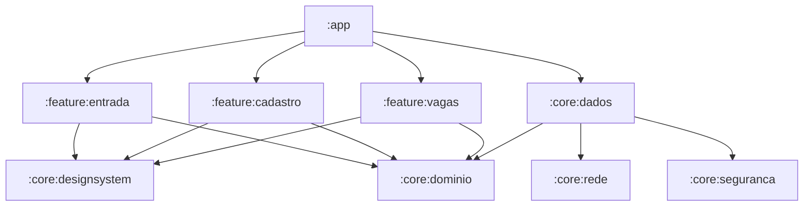

# Proposta Arquitetural e Técnica — Frila Android (v1.1)
**Cartão Trello:** `XTijdYVk` (`v1.1 · Android · Criar o projeto Android (Kotlin) com o domínio e o cliente da API`)  
**Data:** 15 de Outubro de 2026  
**Autor:** Trovão (Engenharia Mobile)  
**Status:** Proposta Técnica para Validação (Documentação)

---

## 1. Visão Geral e Contexto de Negócio

O Frila iniciou sua operação piloto no Distrito Federal focado na plataforma iOS. Contudo, no mercado brasileiro de hospitalidade, alimentação e eventos, mais de **85% dos profissionais diaristas utilizam aparelhos Android** de entrada e intermediários. O lançamento da versão Android (v1.1) é o passo decisivo para atingir liquidez no marketplace e permitir que contratantes preencham vagas de urgência com facilidade.

Conforme a diretriz mestra do projeto, **não há núcleo compartilhado multiplataforma (KMP/Flutter/React Native)**:
- O domínio é reescrito nativamente em **Kotlin**, usufruindo da excelência de performance e estabilidade do sistema operacional.
- Todas as regras críticas de integridade, cálculo e transação permanecem unificadas no backend PostgreSQL/Supabase, expressas pelo contrato normativo **OpenAPI 0.2.41**.
- O aparelho de referência mínimo obrigatório é **Android 9.0 (API 28) com 2 GB de memória RAM** (requisito **RNF04**). O app não pode consumir memória desnecessária nem engasgar na rolagem.

---

## 2. Pilha Tecnológica Recomendada (Stack)

| Camada / Componente | Tecnologia | Racional Técnico |
|---|---|---|
| **Linguagem** | **Kotlin 2.0+** | Tipagem estrita, corrotinas, Kotlinx Serialization e null-safety de primeira classe. |
| **Interface (UI)** | **Jetpack Compose + Material 3** | UI declarativa moderna. Compatível com a escala de densidade do Android e tokens de design do Frila. |
| **Arquitetura** | **Clean Architecture + MVI/MVVM** | Camadas estritas e unidirecionais: Apresentação (`ViewModel` + `StateFlow`), Domínio (casos de uso e modelos puros), Dados (repositórios e clientes remotos). |
| **Asincronismo** | **Kotlin Coroutines & Flow** | Concorrência estruturada, cancelamento cooperativo e observabilidade reativa. |
| **Injeção de Dependência**| **Hilt (Dagger)** ou **Koin** | Injeção estática com ciclo de vida atrelado a componentes Android sem reflexão pesada em runtime. |
| **Rede & HTTP** | **Ktor Client** ou **Retrofit + OkHttp** | Leveza, suporte a streaming/timeouts granulares (15s por requisição, 60s conjunto, igual ao iOS). |
| **Serialização** | **Kotlinx Serialization** | Totalmente em tempo de compilação sem reflexão, otimizada para aparelhos de 2 GB de RAM. |
| **Armazenamento Seguro** | **Jetpack Security (EncryptedSharedPreferences / Tink) + Android Keystore** | Isolamento criptográfico de tokens e chaves atrelado ao hardware do aparelho. |
| **Notificações Push** | **Firebase Cloud Messaging (FCM)** | Serviço em background nativo (`FirebaseMessagingService`) integrado com `/rpc/registrar_dispositivo`. |
| **Testes** | **JUnit 5 + MockK + Turbine + Robolectric** | Testes rápidos de unidade do domínio, asserções de flows reativos e testes de componentes visuais. |

---

## 3. Estrutura Modular Gradle

Para garantir isolamento de dependências, builds rápidos na CI e impedir que bibliotecas de terceiros vazem para o domínio de regras de negócio, o projeto será estruturado em módulos independentes:



### Detalhamento dos Módulos:
1. **`:core:dominio`**:
   - Módulo Kotlin puro (sem dependência do SDK Android).
   - Contém entidades imutáveis (`Conta`, `Vaga`, `Turno`, `Candidatura`), enums de negócio (`ModoPreenchimento`, `EstadoVaga`, etc.), objetos de valor (`Dinheiro`, `Coordenada`, `DataCivil`), interfaces de portas (`ApiCliente`, `ArmazenamentoDeSessao`, `ProvedorDeLocalizacao`) e validadores de regra (RN02, RN15, RN20, RN21).
2. **`:core:dados`**:
   - Implementação das portas do domínio.
   - Gerencia a chamada de RPCs via Supabase, converte payloads para o domínio e controla fila de sincronização de estado.
3. **`:core:seguranca`**:
   - Implementação da sessão segura baseada no Android Keystore com AES-256-GCM.
   - Impede exportação de sessão em backups ADB ou Google Cloud Backup (`allowBackup="false"`).
4. **`:core:designsystem`**:
   - Tokens de cores, tipografia e componentes comuns em Jetpack Compose respeitando as diretrizes de acessibilidade e redução de movimento.
5. **`:feature:entrada`**, **`:feature:cadastro`**, **`:feature:vagas`**:
   - Telas e ViewModels do primeiro marco funcional (Login OTP, Onboarding de Perfil e Feed de Vagas Abertas).

---

## 4. Geração do Cliente e Integração com OpenAPI 0.2.41

A conformidade com o contrato deve seguir a mesma severidade do iOS, prevenindo deriva de contrato em tempo de compilação:

### Abordagem Técnica Recomendada:
- **Ferramenta:** `openapi-generator-cli` (gerador `kotlin` com biblioteca `multiplatform` ou `jvm-ktor`) OU script Python gerador de DTOs tipados integrado ao Gradle.
- **Envelope de Resposta PostgREST:** Todas as 44 RPCs seguem a convenção do Supabase:
  - Respostas 200/204: Payload JSON direto mapeado para DTO imutável com `@Serializable`.
  - Recusas 4xx: Extração imediata do campo `code` (`snake_case`), mapeado para o enum `CodigoErroAPI`. Textos de `message` vão estritamente para logs e nunca para a tela.
- **Gate de Deriva Automático:** Adição de uma tarefa Gradle `:core:dados:conferirContrato` (derivada da mesma lógica do script `contrato-ios-confere.sh`), validando RPCs, Enums e campos obrigatórios antes de rodar os testes unitários.

---

## 5. Autenticação Supabase e Segurança de Sessão

1. **Fluxo OTP por E-mail:**
   - Solicitação: `POST /auth/v1/otp` com e-mail institucional/pessoal (código de 6 dígitos sem link mágico).
   - Verificação: `POST /auth/v1/verify` (type: `email`).
   - Retorno: `Sessao` com `access_token`, `refresh_token`, `token_type: bearer` e `expires_in`.
2. **Segurança de Armazenamento:**
   - O token de autenticação é gravado em `EncryptedSharedPreferences` cifrado com chave mestre em hardware seguro (`MasterKey.Builder` com Keystore nativo).
   - O app declara `android:allowBackup="false"` e desabilita `fullBackupContent` no `AndroidManifest.xml` para evitar clonagem de sessão entre aparelhos físicos.
3. **Modo Demonstração da Google Play:**
   - Suporte ao endpoint `/functions/v1/entrar-demonstracao` permitindo que os revisores da Google Play testem o aplicativo sem acesso a caixas de e-mail de usuários reais.

---

## 6. Notificações Push (Firebase Cloud Messaging - FCM)

1. **Recepção e Roteamento:**
   - Classe nativa `FrilaFirebaseMessagingService` estendendo `FirebaseMessagingService`.
   - Registro automático do token via RPC `/rpc/registrar_dispositivo`:
     ```json
     { "plataforma": "android", "token_fcm": "<FCM_TOKEN>" }
     ```
2. **Canais de Notificação (Android 8.0+ / API 26+):**
   - Criação dos Notification Channels no `Application.onCreate()`:
     - `canal_urgencia`: Prioridade máxima (`IMPORTANCE_HIGH`), som e vibração para novas vagas e convites.
     - `canal_turnos`: Lembretes de turno, avisos de check-in/check-out e atrasos.
     - `canal_geral`: Informações administrativas e suporte.
3. **Respeito ao Modo Doze e Aparelhos de Entrada:**
   - Tratamento de mensagens de dados prioritárias (`priority = high`) do FCM para garantir que avisos urgentes cheguem com o aparelho em repouso profundo sem consumo excessivo de bateria.

---

## 7. Pipeline de Integração Contínua (CI - GitHub Actions)

Diferente do iOS que exige runners macOS caros e lentos, a esteira Android executará em contêineres Linux ultrarrápidos:

- **Ambiente:** `ubuntu-latest` com JDK 17 (Temurin).
- **Tempo médio de execução estimado:** 3 a 5 minutos.
- **Jobs da Pipeline:**
  1. `analise-estatica`: Execução de `ktlintCheck`, `detekt` e `lintDebug`.
  2. `gate-contrato`: Execução do validador de paridade contra `Contrato/openapi.yaml`.
  3. `testes-unitarios`: `testDebugUnitTest` cobrindo regras de negócio do `:core:dominio` e decodificadores do `:core:dados`.
  4. `compilacao-build`: Geração de APK/AAB debug para validação de layout no emulador headless.

---

## 8. Planejamento de Esforço por Épico (Estimativa para v1.1)

| Épico | Entregáveis | Esforço Estimado |
|---|---|:---:|
| **E1: Infraestrutura e Módulos** | Estrutura multi-módulo Gradle, CI no GitHub Actions, Hilt DI, tokens Material 3 em Compose. | 4 dias |
| **E2: Contrato, Rede e Segurança** | Cliente PostgREST/Ktor, DTOs gerados, gate de contrato, armazenamento seguro no Android Keystore. | 5 dias |
| **E3: Autenticação e Onboarding** | Telas de entrada OTP (e-mail + 6 dígitos), modo demo Play Store, cadastro inicial do profissional (RN20 maioridade). | 6 dias |
| **E4: Feed de Vagas e Detalhes** | Listagem de vagas abertas com cálculo de distância (Haversine), filtros por data/função, tela de detalhe e candidatura. | 7 dias |
| **E5: Push FCM e Background** | Serviço FCM, registro de token, roteamento de toques em notificações para deep-links internos. | 4 dias |
| **E6: Homologação e Performance** | Testes de carga e renderização em aparelho real de referência (Android 9, 2 GB RAM), auditoria de bateria e acessibilidade TalkBack. | 4 dias |
| **Total Estimado** | **Entrega do MVP Funcional Android v1.1** | **30 dias úteis** |

---

## 9. Próximos Passos Imediatos

1. Aprovação da proposta técnica e resolução das decisões em aberto com o Dono (registradas em `DECISOES.md`).
2. Criação do diretório `android/` na raiz do repositório após liberação pelo comando do projeto.
3. Configuração dos segredos de teste do Firebase Android (`google-services.json`) no ambiente de desenvolvimento.
