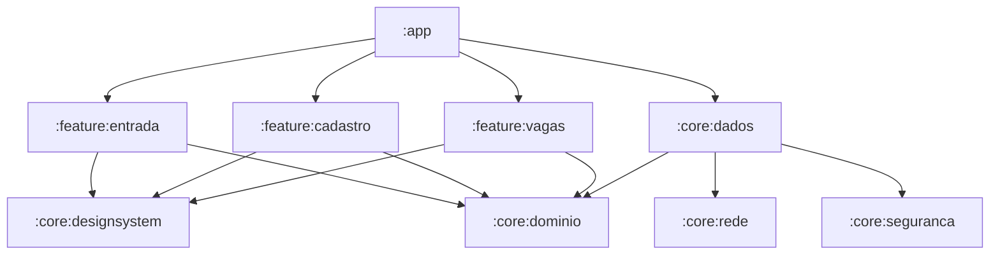

# Proposta Arquitetural e Técnica — Frila Android (v1.1)
**Cartão Trello:** `XTijdYVk` (`v1.1 · Android · Criar o projeto Android (Kotlin) com o domínio e o cliente da API`)  
**Data:** 15 de Outubro de 2026  
**Autor:** Trovão (Engenharia Mobile)  
**Status:** Proposta Técnica para Validação (Documentação)

---

## 1. Visão Geral e Contexto de Negócio

O Frila iniciou sua operação piloto no Distrito Federal focado na plataforma iOS. Contudo, no segmento de hospitalidade, alimentação e eventos no Brasil, o ecossistema Android é amplamente predominante entre trabalhadores operacionais e diaristas. O lançamento da versão Android (v1.1) é o passo decisivo para atingir liquidez no marketplace e garantir alcance popular.

Conforme a diretriz mestra de engenharia do projeto, **não há núcleo compartilhado multiplataforma (KMP/Flutter/React Native)**:
- O domínio é reescrito nativamente em **Kotlin**, usufruindo da excelência de performance e estabilidade do sistema operacional.
- Todas as regras críticas de integridade, cálculo e transação permanecem unificadas no backend PostgreSQL/Supabase, expressas pelo contrato normativo **OpenAPI 0.2.43**.
- O requisito não funcional normativo do projeto é o **RNF04** (*"Android 9 ou superior com 2 GB de memória, iOS 17 ou superior e navegadores modernos"*). Para fins de homologação prática e testes de estresse em hardware real, a equipe de engenharia sugere e adota como perfil de referência de entrada um aparelho com Android 9.0 (API 28), 2 GB de RAM e tela 720p, garantindo que o app não consuma memória excessiva nem apresente perda de quadros na rolagem.

---

## 2. Pilha Tecnológica Recomendada (Stack)

| Camada / Componente | Tecnologia | Racional Técnico |
|---|---|---|
| **Linguagem** | **Kotlin 2.0+** | Tipagem estrita, corrotinas, Kotlinx Serialization e null-safety de primeira classe. |
| **Interface (UI)** | **Jetpack Compose + Material 3** | UI declarativa moderna. Compatível com a escala de densidade do Android e tokens de design do Frila. |
| **Arquitetura** | **Clean Architecture + MVI/MVVM** | Camadas estritas e unidirecionais: Apresentação (`ViewModel` + `StateFlow`), Domínio (casos de uso e modelos puros), Dados (repositórios e clientes remotos). |
| **Asincronismo** | **Kotlin Coroutines & Flow** | Concorrência estruturada, cancelamento cooperativo e observabilidade reativa. |
| **Injeção de Dependência**| **Hilt (Dagger)** ou **Koin** | *A definir pelo Dono:* Hilt (padrão Google com geração estática e ciclo de vida atrelado ao Jetpack) vs Koin (leve, Kotlin puro, sem anotações pesadas). |
| **Rede & HTTP** | **Ktor Client** ou **Retrofit + OkHttp** | *A definir pelo Dono:* Ktor (integração nativa com Kotlinx Serialization) vs Retrofit (padrão consagrado com OkHttp e interceptors robustos). Timeouts: 15s por requisição, 60s conjunto, igual ao iOS. |
| **Serialização** | **Kotlinx Serialization** | Totalmente em tempo de compilação sem reflexão, otimizada para aparelhos de 2 GB de RAM. |
| **Armazenamento Seguro** | **Jetpack Security (EncryptedSharedPreferences / Tink) + Android Keystore** | Isolamento criptográfico de tokens e chaves atrelado ao hardware do aparelho. |
| **Notificações Push** | **Firebase Cloud Messaging (FCM)** | Serviço em background nativo (`FirebaseMessagingService`) integrado com `/rpc/registrar_dispositivo`. |
| **Testes** | **JUnit 5 + MockK + Turbine + Robolectric** | Testes rápidos de unidade do domínio, asserções de flows reativos e testes de componentes visuais. |

---

## 3. Estrutura Modular Gradle

Para garantir isolamento de dependências, builds rápidos na CI e impedir que bibliotecas de terceiros vazem para o domínio de regras de negócio, o projeto será estruturado em módulos independentes:



### Detalhamento dos Módulos:
1. **`:core:dominio`**:
   - Módulo Kotlin puro (sem dependência do SDK Android).
   - Contém entidades imutáveis (`Conta`, `Vaga`, `Turno`, `Candidatura`), enums de negócio (`ModoPreenchimento`, `EstadoVaga`, etc.), objetos de valor (`Dinheiro`, `Coordenada`, `DataCivil`), interfaces de portas (`ApiCliente`, `ArmazenamentoDeSessao`, `ProvedorDeLocalizacao`) e validadores de regra (RN02, RN15, RN20, RN21).
2. **`:core:dados`**:
   - Implementação das portas do domínio.
   - Gerencia a chamada de RPCs via Supabase, converte payloads para o domínio e controla fila de sincronização de estado.
3. **`:core:seguranca`**:
   - Implementação da sessão segura baseada no Android Keystore com AES-256-GCM.
   - Impede exportação de sessão em backups ADB ou Google Cloud Backup (`allowBackup="false"`).
4. **`:core:designsystem`**:
   - Tokens de cores, tipografia e componentes comuns em Jetpack Compose respeitando as diretrizes de acessibilidade e redução de movimento.
5. **`:feature:entrada`**, **`:feature:cadastro`**, **`:feature:vagas`**:
   - Telas e ViewModels dos marcos funcionais seguintes da v1.1 (Login OTP, Onboarding de Perfil e Feed de Vagas Abertas).

---

## 4. Geração do Cliente e Integração com OpenAPI 0.2.43

A conformidade com o contrato deve seguir a mesma severidade do iOS, prevenindo deriva de contrato em tempo de compilação:

### Abordagem Técnica:
- **Geração de DTOs e Serviços:** Geração estática versionada de DTOs tipados com Kotlinx Serialization a partir de `Contrato/openapi.yaml`, validada via script ou tarefa Gradle.
- **Envelope de Resposta PostgREST:** Todas as 44 RPCs seguem a convenção do Supabase:
  - Respostas 200/204: Payload JSON direto mapeado para DTO imutável com `@Serializable`.
  - Recusas 4xx: Extração imediata do campo `code` (`snake_case`), mapeado para o enum fechado `CodigoErroAPI`. Textos de `message` vão estritamente para logs e nunca para a tela.
- **Gate de Deriva Automático:** Adição de tarefa Gradle de conferência (derivada da mesma especificação do `contrato-ios-confere.sh`), validando RPCs, Enums e campos obrigatórios antes da suíte de testes unitários.

---

## 5. Autenticação Supabase e Segurança de Sessão

1. **Fluxo OTP por E-mail:**
   - Solicitação: `POST /auth/v1/otp` com e-mail institucional/pessoal (código de 6 dígitos sem link mágico).
   - Verificação: `POST /auth/v1/verify` (type: `email`).
   - Retorno: `Sessao` com `access_token`, `refresh_token`, `token_type: bearer` e `expires_in`.
2. **Segurança de Armazenamento e Regras de Extração (Privacidade):**
   - O token de autenticação é gravado em `EncryptedSharedPreferences` cifrado com chave mestre em hardware seguro (`MasterKey.Builder` com Keystore nativo).
   - **Regras de Backup e Extração (Android 12+ / API 31+):**
     - O app declara `android:dataExtractionRules="@xml/data_extraction_rules"` para Android 12+ (API 31+) e `android:fullBackupContent="@xml/backup_rules"` para versões legadas, com `android:allowBackup="false"`.
     - As regras bloqueiam explicitamente a transferência de credenciais (`sharedpref`, `keystore`, tokens de sessão e identificadores de aparelho), impedindo a exportação de dados de sessão via backup em nuvem (Google Drive) ou migração física cabo/aparelho (device-to-device transfer), em total conformidade com a LGPD e RN15.
3. **Modo Demonstração da Google Play:**
   - Suporte ao endpoint `/functions/v1/entrar-demonstracao` permitindo que os revisores da Google Play testem o aplicativo sem acesso a caixas de e-mail de usuários reais.

---

## 6. Notificações Push (Firebase Cloud Messaging - FCM)

1. **Recepção e Registro de Aparelho:**
   - Classe nativa `FrilaFirebaseMessagingService` estendendo `FirebaseMessagingService`.
   - Registro automático do token via RPC `/rpc/registrar_dispositivo`:
     ```json
     { "plataforma": "android", "token_fcm": "<FCM_TOKEN>" }
     ```
2. **Isolamento de Contas e `vinculo_id` (RN15):**
   - Em aparelhos compartilhados (ex.: dois profissionais usando o mesmo smartphone), o payload de notificação transporta a chave `vinculo_id` (contrato 0.2.30).
   - O serviço `FrilaFirebaseMessagingService` deve validar se o `vinculo_id` recebido coincide com o ID de vínculo da sessão ativa gravado no Keystore.
   - Caso a notificação pertença a uma conta deslogada ou anterior, o conteúdo sensível da notificação é imediatamente neutralizado (exibindo apenas mensagem genérica *"Frila: Nova notificação disponível"*), impedindo vazamento de dados de terceiros.
3. **Lacuna no Backend (Extensão da Edge Function `enviar-push`):**
   > [!IMPORTANT]
   > **Lacuna no Backend (Edge Function `enviar-push`):**
   > O backend atualmente monta o payload FCM com foco exclusivo no bloco `apns` para iOS. Não há configuração do bloco `android` (sem definição de canal ou prioridade de entrega no servidor), e essa extensão de payload Android ainda não possui cartão nem PR aberto no backend (recomenda-se abrir um cartão técnico no repositório `frila-backend`). Para que o Android receba notificações com prioridade máxima e bypass de Doze mode em vagas urgentes, a Edge Function precisará ser estendida para suportar o bloco:
   > ```json
   > "android": {
   >   "priority": "high",
   >   "notification": {
   >     "channel_id": "canal_urgencia"
   >   }
   > }
   > ```
   > Enquanto essa alteração não for implementada no backend, o app Android fará o tratamento recebendo dados brutos em `RemoteMessage.data` e exibindo as notificações através de `NotificationCompat` local.

4. **Canais de Notificação Locais (Android 8.0+ / API 26+):**
   - Canais configurados no `Application.onCreate()`:
     - `canal_urgencia`: Prioridade máxima (`IMPORTANCE_HIGH`), som e vibração para novas vagas e convites.
     - `canal_turnos`: Lembretes de turno, avisos de check-in/check-out e atrasos.
     - `canal_geral`: Informações administrativas e suporte.

---

## 7. Pipeline de Integração Contínua (CI - GitHub Actions)

Diferente do iOS que exige runners macOS caros e lentos, a esteira Android executará em contêineres Linux ultrarrápidos:

- **Ambiente:** `ubuntu-latest` com JDK 17 (Temurin).
- **Tempo médio de execução estimado:** 3 a 5 minutos.
- **Jobs da Pipeline:**
  1. `analise-estatica`: Execução de `ktlintCheck`, `detekt` e `lintDebug`.
  2. `gate-contrato`: Execução do validador de paridade contra `Contrato/openapi.yaml`.
  3. `testes-unitarios`: `testDebugUnitTest` cobrindo regras de negócio do `:core:dominio` e decodificadores do `:core:dados`.
  4. `compilacao-build`: Geração de APK/AAB debug para validação de layout no emulador headless.

---

## 8. Escopo do Cartão XTijdYVk e Cronograma por Épico

O cartão **`XTijdYVk`** tem como objetivo estabelecer os alicerces do projeto Android: arquitetura, domínio, cliente de API e segurança. Seu escopo estrito é composto pelos **Épicos E1 e E2**:

| Épico | Escopo / Entregáveis | Esforço | Status |
|---|---|:---:|:---:|
| **E1: Base do Projeto e Módulos** | Projeto em subpasta `android/`, estrutura multi-módulo Gradle, CI no GitHub Actions, tokens Material 3 em Compose. | 4 dias | **Escopo do Cartão XTijdYVk** |
| **E2: Domínio, Contrato e Sessão** | Regras puras no `:core:dominio`, DTOs OpenAPI 0.2.43, cliente PostgREST, gate de contrato, armazenamento seguro no Keystore. | 5 dias | **Escopo do Cartão XTijdYVk** |
| *Subtotal XTijdYVk* | *Entrega do alicerce técnico e domínio testado na CI* | **9 dias úteis** | *Meta do cartão* |
| **E3: Entrada e Cadastro** | Telas de entrada OTP (e-mail + 6 dígitos), modo demo Play Store, cadastro do profissional (RN20). | 6 dias | Cartão seguinte v1.1 |
| **E4: Feed de Vagas e Detalhes** | Listagem de vagas abertas com cálculo de distância (Haversine), filtros, tela de detalhe e candidatura. | 7 dias | Cartão seguinte v1.1 |
| **E5: Push FCM e Background** | Serviço FCM nativo, tratamento de `vinculo_id` e roteamento de toques em notificações. | 4 dias | Cartão seguinte v1.1 |
| **E6: Homologação e Performance** | Prova em aparelho real de referência (Android 9, 2 GB RAM), auditoria de bateria e TalkBack. | 4 dias | Cartão seguinte v1.1 |

---

## 9. Decisões em Aberto para o Dono

1. **Injeção de Dependência:** Hilt (recomendado pela integração nativa com AndroidX) vs Koin (leveza e simplicidade).
2. **Cliente HTTP / Supabase:** Ktor Client (moderno e multi-módulo) vs Retrofit + OkHttp (maduro e consagrado).
3. **Estrutura de Repositório:** Monorepo em subpasta `android/` no `frila-frontend` (Recomendado) vs repositório dedicado `frila-android`.
4. **Google Play Console:** Cadastro/configuração da conta de desenvolvedor institucional e provisionamento dos segredos de upload no GitHub Secrets.
