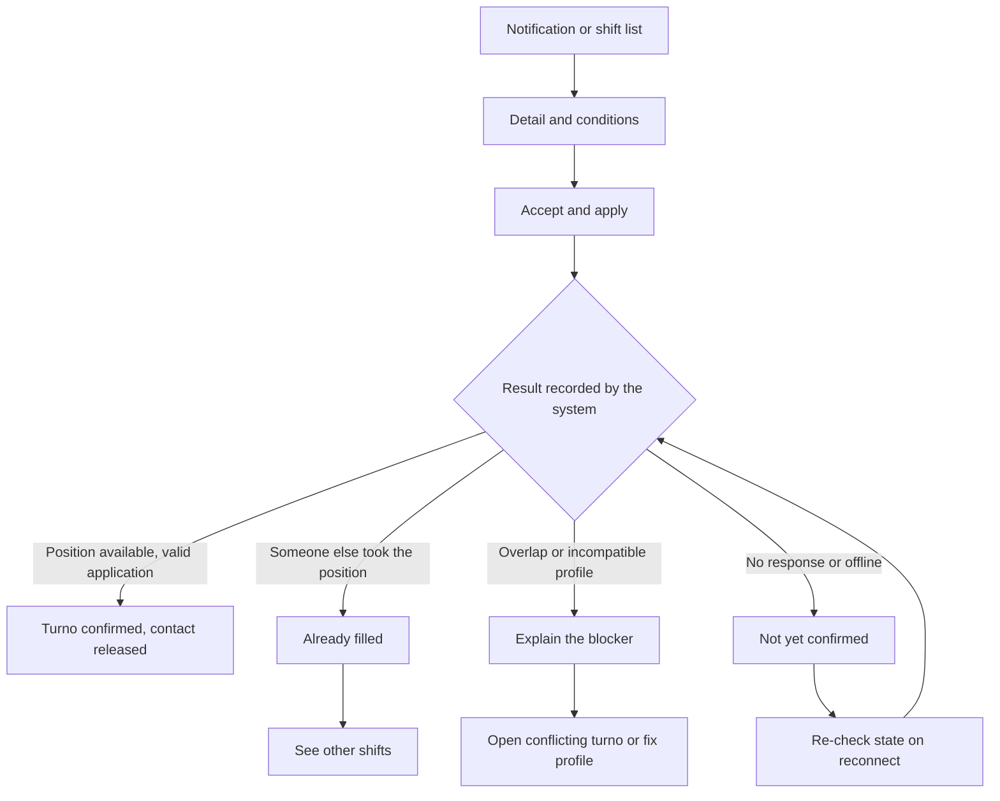
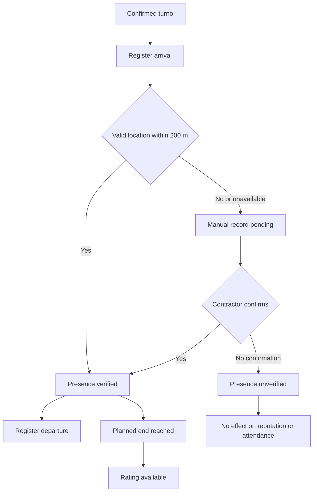

# Frila — Design Source Document

**v0.3 · 2026-09-29 · draft for team review**

Single source for anyone drawing Frila's **user / task / interaction flows**: who uses it, where, which paths, under which rules, what each state says, and what happens off the happy path.

**Scope.** Macro paths, states and interaction rules (steps, not pixels). No Design System (color, type, components, tokens, spacing). Requirements stay authoritative for fine detail.
**Conventions.** UI copy stays in pt-BR, quoted. `[v1.0]` `[v1.1]` `[v1.2]` = release. `[UX]` = interaction guideline to validate in prototype, not an approved screen. `[H]` = unvalidated product hypothesis. `[OPEN]` = pending decision (§13). Unmarked statements are product rules.
**Sources.** Product docs `produto/00–05`, README, EVIDENCIAS, Vision Doc v1.2.0 (PROD) · `produto/06-FUNDAMENTOS-DE-DESIGN-E-UX` v1.0, frila-docs issue #25 (FND) · Requirements v1.3.0 + Backlog v1.2.0 (RF/RN/RNF/US) · use-case, DB-state and critical-path diagrams, `openapi.yaml` v0.2.20 (UC/BD/API) · low-fi prototype, 17 screens (PROTO).
**Precedence on conflict.** Requirements/API > `05-ESCOPO-DO-MVP` > FND (for UX guidance and states) > other product docs > prototype (low-fi: intent of path and tone, never spec). Resolutions in §14.

**Changelog v0.3.** Incorporates FND: the four uncertainty questions, vocabulary (vaga/posição/turno), explicit-state and recovery principles, the offline-acceptance outcome, presence window, cancellation matrix, reputation vs attendance display, commitment state messages, offline behavior, notification destinations, UX patterns, accessibility guidelines, microcopy, validation tasks, and eleven new open decisions. Divergences logged in §14.

---

## 1. Product in brief

Contractor posts a one-off shift; Frila **pushes** it to professionals with the role, matching availability, within 15 km; professional accepts in one tap; in urgency mode **first to accept wins** (per open position). On confirmation, contacts are released (conversation continues on WhatsApp). On the day, location check-in measures attendance; afterwards each side answers one binary question ("chamaria de novo?" / "trabalharia lá de novo?").

Frila does **not** process payment, charge the professional, offer chat, or arbitrate disputes.

Differentiator is **certainty (knowing who shows up)**, not speed — WhatsApp is already fast and free. Every flow must make that gain visible at no more effort than a group message.

**The four questions every step must answer (FND).** Design reduces uncertainty around:
1. **Posso aceitar?** Role, time, commute, pay, conditions and reputation are clear.
2. **O compromisso está confirmado?** The professional knows the position is theirs; the contractor knows who is coming.
3. **O turno aconteceu?** Arrival, departure and pending verifications have understandable records.
4. **O que acontece se algo der errado?** Cancellation, delay, location failure and reporting have visible paths.

At any step the UI answers: *what is happening, what is already confirmed, what I must do now, what happens next.*

Research reports (unsolicited applications with no answer, missed notices, blocking signups, incomplete job info, unexplained punishment) justify design care; they don't measure frequency among Frila users. Frequency of urgent hiring, professional availability at the moment of need, understanding of binary reputation and willingness to switch remain `[H]`. None of them allows promising guaranteed filling, guaranteed payment, or hiring within a fixed time.

---

## 2. Actors and context

| Actor | Who / context | Needs from the experience |
|---|---|---|
| **Contractor in operation** (primary persona) | Whoever covers a gap or reinforces a team: manager, maître, head chef, supervisor, or owner who also operates. Phone, on the floor, under pressure, minutes ("Friday 4pm, short-staffed") | Post as fast as a group message; know who is confirmed and who arrived; be alerted if nothing happens. Not assumed to sit in front of a panel |
| **Contractor — events** | Producer/buffet planning 20–40-person rosters weeks ahead, mostly on desktop; still gets last-minute no-shows | Assemble and track a roster per role, reuse crews, accountability history `[v1.1]`/`[v1.2]`. Must not add complexity to the v1.0 urgent flow |
| **Professional** (18+) | Any in-person shift work, not only waiter: bartender, cook, kitchen aide, event staff. Entry-level Android (iOS in pilot), commuting, one hand, little attention, unstable signal, limited data, short sessions, many WhatsApp groups | Be **called**, not just registered; compare opportunities; see address/time/pay/inclusions before accepting; know when confirmed; no unexplained punishment |
| **Frila team** | Email only, ≤5 business days | Receives reports, contestations, support. Doesn't watch or intervene in shifts |
| **Frila (system)** | Dispatcher + scheduler; not a UC actor | Notifies, groups, reminds, alerts, closes, requests ratings — it "speaks" most to users |

- **Peak:** Thu–Sun 16h–02h + seasonal dates. Shifts **crossing midnight** are common; every screen must read them right (RNF15).
- **One account = one profile** (RN25), fixed at signup, **no profile switching** in any flow. Both roles = two accounts/two emails (phone may repeat).
- **The venue (estabelecimento) is the contractor's identity.** Its history is not the personal history of whoever operates it.
- Manager = contractor using the web Panel `[v1.2]`; the Panel is contractor experience, not a Frila team watching shifts. Admin/operator = roles within the contractor profile `[v1.2]`.
- All personas `[H]`.

---

## 3. Experience principles

When two paths tie, the one honoring more principles wins. "→" = consequence for flow design.

1. **The shift goes to the person.** Push is the professional's natural entry; the list is a safety net. → *Every professional flow starts at push and must also work without it.*
2. **Post and forget.** Contractor acts again only when Frila calls (empty shift, delay, manual check-in, rating). → *No v1.0 contractor flow requires watching the screen.*
3. **Each extra friction is an unfilled shift.** Minimal signup (no password/SMS/document photo/résumé/selfie), form-free acceptance, repost changes only the date, short forms grouped by subject, data reused, one primary action per step, resume after interruption. → *Ask later, or never.*
4. **Decide with information.** Professional sees pay per person, full time, address, inclusions, who receives them, contractor reputation before accepting; contractor sees "chamaria de novo" + attendance. → *No acceptance without these shown.*
5. **Explicit state.** Published, confirmed, awaiting upload and pending presence never share the same success message. → *A state is shown only once the system has recorded it; animations, received pushes or locally saved requests never reserve a position.*
6. **Losing the race is normal, not an error.** "Já preenchida" is an expected outcome; neutral tone; next step is another shift. → *Race outcomes are first-class states with a clear exit, never an error screen.*
7. **No application without an outcome.** Competitors' #1 complaint: "apply and never called". → *No indefinite "pending" state.*
8. **Measure without punishing.** Ignoring/declining costs nothing (RN16); canceling never suspends (RN13); attendance rate informs contractors but **doesn't change who receives shifts**; suspension only for confirmed serious report, always with reason + contestation. → *Explain every negative consequence before the person acts, without blame or threat.*
9. **Reputation with denominator.** Always "7 de 8"; no history never looks like failure, never zero. Only co-workers, only after verified presence. → *Rating = one question, one tap, shown only when legitimate.*
10. **Visible privacy.** Data and permissions asked with a stated purpose; contact appears only after confirmation, vanishes 7 days after shift (also in offline copies); location read **only on tap** at check-in/out, never in background. → *Contact-sharing notice comes before acceptance.*
11. **Recoverable failure.** Every relevant failure states the situation, preserves what was filled in, and offers a next action matching the cause. → *Never lose a half-filled form to an error.*
12. **Respect attention.** Notifications useful, contextual, grouped; each operational alert opens the matching shift or position. → *No notification without a destination.*
13. **State never depends on push** (RNF02/03). → *Every notification has a matching place inside the app.*
14. **Light and offline-tolerant.** <2 s on 4G, <1 MB/session (targets to verify, not results), confirmed shift readable 24 h offline, offline actions queued and shown as queued. → *Day-of shift data (address, time, contact, receiver) never needs connectivity.*
15. **No training.** No tutorial/assisted onboarding. VoiceOver/TalkBack, max dynamic type, WCAG AA on all core flows. → *If a flow needs explaining, the flow is wrong.*

Speed is a usability goal, not a promotional stopwatch: time targets for posting or accepting come from observing real users (§12).

---

## 4. Experience structure

### 4.1 Surfaces

| Surface | Who | Release |
|---|---|---|
| iOS app (17+) | Both | `[v1.0]` — store minimum, 13/11 |
| Push, incl. grouped | Both | `[v1.0]` |
| Email | Both | Login code `[v1.0]`; support/contestation replies |
| WhatsApp / phone (outside Frila) | Both | After confirmation, via "Chamar no WhatsApp" — an external exit, never presented as Frila chat |
| Android | Both | `[v1.2]` — risk: professional persona's device |
| Web Panel | Contractor | `[v1.2]` — batch tracking, manual check-in, export |

In v1.0 **everything the Panel would do happens in the contractor app**: empty-shift alert, wait/reopen decision, manual check-in confirmation. Future capabilities don't appear as empty tabs or disabled actions.

### 4.2 Vocabulary (FND)

| Term | Meaning | UI implication |
|---|---|---|
| **Vaga** | Listing of one role, at a place and time, with one or more positions | May stay open after confirming someone |
| **Posição** | One person's slot inside a vaga | Four waiters = four positions; show "2 de 4 confirmados". To the contractor, ask "Quantas pessoas?" instead of teaching "posição" |
| **Candidatura** | Showing interest and accepting the conditions | In v1.0 it may confirm immediately; never implies waiting for contractor approval |
| **Turno (confirmado)** | Commitment recorded between a professional and the venue | Destination for conditions, contact, arrival, departure, cancellation |
| **Presença verificada** | Arrival by valid location, or manual record confirmed by contractor | Not payment done, not a positive rating |
| **Reputação** | Answers received to the "again?" question | Positives + total answers |
| **Comparecimento** | Professional's presences over considered shifts, faults included | Separate indicator from reputation |

Use **"vaga"** for discovery and posting, **"turno"** for the commitment taken.

### 4.3 Macro navigation `[UX]`

Common entry (email → code → profile+data) → split:

| Profile | Area | Main content |
|---|---|---|
| Professional | *Vagas* (home) | DF list, filters, detail; alternative entry to notifications |
| Professional | *Meus turnos* | Today and upcoming, then history; arrival, departure and pending items in the detail. Current shift has a stable highlight |
| Professional | *Perfil* | Roles, home base, hours, reputation, "Por que recebo vagas", help, account |
| Contractor | *Minhas vagas* (home) | Open and confirmed positions, alerts, **Publicar vaga** action, access to repost |
| Contractor | *Turnos* | Professionals of the day, presence, manual confirmation, rating, history |
| Contractor | *Perfil* | Venue identity, reputation, help, account |

No messages area (there is no chat) and no pending-applications area in urgency mode. PROTO labels differ (contractor *Publicar* as a tab, *Estabelecimento*): see §14. Account area needed for **both** profiles (sign out, delete account, report/block, data export, terms, privacy, support email) — PROTO lacks it for the contractor; in-app deletion is an App Store rule (5.1.1).

### 4.4 Entry points and notification destinations

| Event | Who | Lands on |
|---|---|---|
| App open | Both | Profile home |
| New compatible shift (individual push) | Prof. | Updated shift detail |
| Grouped push ("3 vagas novas perto de você") | Prof. | List of those shifts still available, not a detail `[UX]` |
| Confirmation | Both | Confirmed turno |
| Reminder 24 h / 3 h | Both | Turno with place, time, permitted contact |
| Start with no arrival recorded | Prof. | Register-arrival action |
| T+15 without check-in | Contr. | Turno with wait / reopen for delay |
| Pending manual check-in | Contr. | Confirm that person's presence |
| Position still open at critical window | Contr. | Vaga and how many are still needed |
| Scheduled end without departure | Both | Turno record and departure state |
| Cancellation | Counterpart | Canceled turno and reopen result, if any |
| Rating available | Both | Own side's question |
| Suspension or reinstatement | Account holder | Account status and available action |

Opening an old notification re-reads the current state. If login is needed, keep the intended destination and resolve its state after login. If the content is no longer accessible, explain unavailability without revealing blocks or the other party's data. A double tap never creates a second commitment. Previews carry no personal contact or sensitive data.

---

## 5. Journeys — v1.0 (urgency mode only)

Steps, not screens; each step expands into detailed flows.

### 5.1 Common entry
`Email → emailed code → [account exists? → home] | [new: choose profile (work/hire) → name, phone, birth date → accept terms and privacy → profile onboarding]`

- Login = signup, one path; each email is one account.
- **Code before profile** (UC09, PROTO; US01 differs — §14). Code parameters (digits, validity, resend interval) come from the API; don't invent them in copy (§14).
- Under-18 refused (RN20). Birth date is required; a "sou maior de 18" checkbox alone doesn't replace it.
- Phone required, format-validated, **no SMS confirmation**. No password, résumé, selfie or document photo at first access.
- Profile choice states its consequence and that it's **fixed** ("Este e-mail será usado para trabalhar em turnos" / "…para contratar profissionais"); correctable until signup completes.
- Code screen `[UX]`: paste support, show destination email, fix the address, request a new code when allowed. Distinguish wrong code, expired code, resend cooldown and connection failure. Keep entered data on back/retry.
- Notification permission asked after profile ready, with explanation. Denial path §9.

### 5.2 Contractor — post and wait
`Register venue → Minhas vagas → Publicar vaga → fill conditions → review summary → publish → Wait (Frila dispatches) → filled? yes: Confirmed + contact | no, at critical window: Empty-shift alert → act → Day of shift: track arrivals → Confirm manual check-in if any → Rate ("chamaria de novo?")`

| Step | Flow-relevant facts |
|---|---|
| Venue | Name, CNPJ **or** CPF (copy must not assume every contractor is a company), address confirmed on map when needed, responsible person. Address-search failure allows correction without losing the rest. Duplicate document has its own message; never instruct to register the same venue again. Goal: first shift posted **in the same session** |
| Post | Single form, fields grouped (below). Returns immediately; dispatch runs after. Complements behind progressive disclosure; required fields never hidden in an area that looks optional |
| Review | Summary on the same screen, not a chain of confirmations. States before publishing: "O primeiro profissional elegível que aceitar será confirmado automaticamente". No later contractor-approval step |
| After publish | "Vaga publicada" + how many positions remain open. Publishing, dispatching and filling are different events: never "equipe garantida" or "todos receberam" |
| Repost | Past shift → "Repetir vaga" → new date/time → review copied data → publish a **new** shift, distinguishable from the original; history untouched. First item cut if schedule slips |
| Wait | No action. Home shows each shift's state: open, partial ("1 de 2"), filled |
| No eligible | Shift stays in DF list; contractor is told there are no eligible professionals (timing `[OPEN]` §13) |
| Empty shift | At critical window: how many are missing and when the shift starts. Exits `[OPEN]` — editing a published shift is not a closed capability |
| Day of shift | Per-position arrival: verified / pending (manual) / late |
| Rate | One Yes/No question, verified presence only |

**Post form groups (FND):**

| Group | Information | Presentation |
|---|---|---|
| Work | Role (closed catalog) and number of people, 1–200 | One role per shift |
| When | Start and end date and time | Show both dates when crossing midnight |
| Where | Address, map point, who receives on site | Prefill venue address; allow the real work location |
| Pay | Positive value per person per shift, in BRL | Label "Valor por pessoa". Any computed total is labeled as the combined value for all positions, never a Frila charge |
| Conditions | Meal, transport, own-equipment requirement | Explicit Yes/No each; "exige material" must not read as a benefit |
| Complements (optional) | Dress code, share of the 10% service split, notes | Make items not informed clear too |
| Alert | Lead time for the empty-position alert | Default 3 h, adjustable, shown in time language |

### 5.3 Professional — configure, receive, decide, go
`Roles + home base + weekly hours → notifications explained → permission → Receive (push or list) → View shift + venue reputation → Accept (1 tap) → {confirmed → Meu turno + contact | already filled → other shifts | ineligible → explanation | no response/offline → not yet confirmed, re-check on reconnect} → Reminders 24 h/3 h → Check-in ≤200 m → Check-out → Rate ("trabalharia lá de novo?")`

| Step | Flow-relevant facts |
|---|---|
| Configure | ≥1 role (closed catalog), home base (declared proximity reference, not live location), weekly grid accepting windows that cross midnight (Fri 18h → Sat 2h). No "disponível agora", no configurable radius. Empty grid can be saved, with a clear warning that no shift notices will arrive |
| Receive | Individual/grouped push. List shows **all** open DF shifts, filters by role, date, distance, ordered nearest first. The 15 km notice radius is **not** a browsing limit: being beyond 15 km alone never produces "Você não pode se candidatar" |
| Compare | Cards keep the same information order: role, venue, region, date, start and end, pay per person, distance, inclusions, positions left. Distance states its reference; never converted into a guaranteed travel time |
| Decide | Detail adds full address, who receives, extra conditions, venue reputation with denominator, and the **notice that phone/WhatsApp will be shared** if confirmed |
| Accept | No cover letter, negotiation, mandatory conversation or justification. Label "Aceitar e me candidatar" `[UX]` (or "Candidatar-me" if the immediate commitment is unmistakable). Guard against repeated taps without hiding the state. Confirmation shown only once recorded |
| Outcomes | Confirmed · Already filled ("Esta vaga já foi preenchida. Você pode ver outras vagas.") · Ineligible (overlap → show the conflicting turno, no "confirm anyway", never auto-cancel it; incompatible profile → how to fix) · Unconfirmed (no response/offline → re-check state on reconnect before repeating or declaring failure) |
| Meu turno | Composition `[UX]`: status on top → commitment summary → next action → place and arrival → contact → other conditions and history. "Cancelar turno", "Denunciar", "Bloquear" findable with less weight than the primary action. Offline-readable 24 h |
| Check-in/out | Location only on tap, ≤200 m. Fallback: manual record, valid only once contractor confirms |
| Rate | One Yes/No question, verified presence only |

**Accept flow (FND):**

### 5.4 Confirmed commitment (both sides)

Both sides see the same data: role, date, planned start and end, address, agreed pay, conditions, the other party's identification and available contact. Contact: only after confirmation, until 7 days after planned end; the UI states this limit and enforces it in offline copies too; a block cuts it.

**Pay wording.** Pay is agreed and paid directly between the parties. Use "Valor acordado: R$ 140,00" and "Pagamento direto com o contratante". Never "Saldo a receber", "Pix liberado", "Pagamento aprovado". Recording the value doesn't prove settlement. No overtime computation; exceeded time never becomes an automatic charge.

Today and upcoming turnos before history; history newest first. A notice opens the right commitment without making the user find it in a list.

### 5.5 Presence

- Departure is decoupled from rating: rating depends on planned end + verified presence only. Never condition rating on payment or on departure.
- Presence window: from **60 min before start** to **planned end**. Departure after the planned end is `[OPEN]` (§13); don't invent an extra deadline in the UI.
- **Manual flow:** explain why → send record → "Aguardando confirmação de presença" → contractor sees person, turno and time → confirms → both see "Presença confirmada". The professional never confirms their own record; never show verified before the answer. Deadline for "pending → unverified" is `[OPEN]`.
- At start without arrival: reminder to professional. T+15 without check-in: contractor alert, wait or reopen for delay. Missing record is not presented as incontestable proof of fault: an upload may be pending.
- Planned end passed without departure: both warned.

### 5.6 Critical path (where journeys meet)
"The whole product depends on this sequence fitting in a few minutes."
`Contractor posts → Frila: published (screen can close) → push to eligible (≤30 s) → professional accepts (1 tap) → first per position: both get confirmed + contact | others: "já preenchida" + other shifts → still empty at critical window: contractor alert`

---

## 6. Objects and states (user-perceived)

**Shift (vaga)** — groups N positions.

| State | Contractor sees | Professional sees |
|---|---|---|
| Published, no one | "Aberta, ainda sem candidatos" | Available |
| Published, partial | "1 de 2 confirmadas" | Available (remaining positions) |
| Filled | All confirmed → go to tracking | Leaves list; viewers see "já preenchida" → other shifts |
| In alert | Empty-shift highlight at critical window | — |
| Closed (encerrada) | No longer accepts applications | Unavailable — never worded as "filled by someone else" |
| Canceled (whole) | With reason; no fault for anyone | Confirmed people notified; must not look like an active turno |

Shift **leaves the list** at start even with an open position. Delay-reopened positions: eligibility after start is `[OPEN]` (§14).

**Position** (unit a professional fills)
`Open → Confirmed (first accept) → Fulfilled (check-out or scheduled end)` · `Confirmed → Canceled (cancel/delay reopen) → Open (before start: substitute position + re-notify) | Uncovered (after start)`. No "reserved" state. Confirmation releases contact.

**Application**
- v1.0: no waiting; accept returns confirmed / already filled / ineligible / not yet confirmed (offline).
- v1.1 (selection): pending → chosen / not chosen / withdrawn (by professional, no penalty) / expired (shift auto-closes at T−24 h with no choice). All candidates notified and released. "Candidatura enviada" and "Turno confirmado" are distinct states.

**Commitment and presence messages (FND).** "Confirmado", "Em andamento", "Concluído" may be display labels but are derived from real records: the clock passing proves no presence, departure, rating or payment. Shown in detail and relevant summaries, not only in transient toasts.

| Situation | Core message | Next action |
|---|---|---|
| Confirmed, before shift | "Seu turno está confirmado" | See conditions, contact, address |
| Arrival window open | "Registre sua chegada ao local" | Register arrival |
| Saved without network | "Salvo neste aparelho. Aguardando envio" | Reconnect, follow sync |
| Manual record sent | "Aguardando confirmação de presença" | Contractor confirms; professional follows |
| Presence verified | "Presença confirmada às 18h02" | Register departure when applicable |
| No check-in after tolerance | "Ainda não há registro de chegada" | Contractor weighs wait or reopen |
| Departure recorded | "Saída registrada às 23h58" | See record; rate when allowed |
| Presence unverified | "Este turno não teve a presença confirmada" | See explanation and help |
| Cancellation confirmed | "Turno cancelado" | See reason, effect, new opportunities |
| Rating available | The "again?" question | Answer Yes or No |
| Contact expired | "O prazo de acesso ao contato terminou" | See available history |

**Presence**

| State | Arises from | Effect |
|---|---|---|
| Verified | Check-in ≤200 m, or manual confirmed by contractor | Counts in attendance rate; unlocks rating |
| Pending | Manual check-in awaiting contractor | Waits |
| Unverified | Manual never confirmed | Neutral: outside rate, no rating |
| Fault | No-show (delay reopen) or professional cancel <24 h | Counts as fault. **Never suspends** |

**Account:** incomplete (receives no shifts) → active → suspended (only serious confirmed report) → contestation → reinstated/kept. Deletion §10.

---

## 7. Behavior rules

`[H]` = calibrate in pilot.

| Rule | Value | Src |
|---|---|---|
| Dispatch eligibility | Has role; start falls in a grid window; home base ≤15 km; active account; no block between parties; no overlapping confirmed shift | RN05, BD |
| Radius | 15 km, fixed, never widened; notice radius only, not a browsing limit `[H]` | RN05, FND |
| Dispatch order | All at once; no waves/order/reputation ranking/paid priority | RF06, RN06 |
| Notification cap | 1 opportunity notice per 30 min per professional, grouped; urgency starting <2 h bypasses grouping but counts toward cap. Operational notices (confirmation, presence, cancellation) are outside the cap | RN23, FND |
| Time to push | ≤30 s from post/reopen; "dispatch started" ≠ "professional notified and available" | RF06, FND |
| Who gets the position (urgency) | First eligible to accept, per available position; never double confirmation | RN19, RNF14 |
| Selection mode `[v1.1]` | Only if start >24 h away; auto-closes at T−24 h | RN24 |
| Trusted crew `[v1.1]` | May notify known professionals beyond 15 km; role, availability and other criteria still apply; no exclusivity, reservation or time advantage | RN05, FND |
| Positions per shift | 1–200, one role per shift | FND |
| Contact | Released on confirmation; visible until 7 days after end; cut by block | RN10, FND |
| Check-in/out | Location only on tap; ≤200 m `[H]`; window 60 min before start → planned end | RF13, FND |
| Critical window | 3 h before start, adjustable at post | RF20 |
| Reminders | 24 h, 3 h before; one at start if no check-in | RF12 |
| Delay | Contractor alert at T+15 min; wait or reopen (reopen = fault) | RF13 |
| Fault | No-show, or professional cancels <24 h. Contractor cancel never a fault. Exactly 24 h `[OPEN]` | RN13 |
| Suspension | Only confirmed serious report; never for cancellation | RN13 |
| Decline/ignore shift | No penalty | RN16 |
| Rating | Binary, one per side, after scheduled end, verified presence only; Yes/No with equal weight, nothing preselected | RF15, FND |
| Reputation denominator | Answers actually received; not answering ≠ No; counterpart sees aggregate only | FND |
| Attendance base | Verified presences + faults; excludes unverified, future, not-chosen applications, cancels >24 h | FND |
| Pay | Advertised = full; per person per shift; no commission; not negotiable; paid outside app | RN01/03/09 |
| Age | 18+, birth date required | RN20 |
| Frila team reply | ≤5 business days, email | UC14/15 |
| Data erasure | ≤15 days | RN15 |
| Area | DF only, in-person only. Remote work is post-MVP with no closed flow (rethinks proximity and presence) | PROD, FND |
| Time and money | pt-BR, BRL, Brasília time | FND |

---

## 8. Shift timeline (who is told what, when)

| Moment | Professional | Contractor |
|---|---|---|
| Post (T0) | Push ≤30 s if eligible | "Vaga publicada"; may close app |
| Confirmation | Confirmed + contact | Position confirmed + contact |
| T−24 h | Reminder; from here canceling = fault | Reminder; `[v1.1]` selection closes if none chosen |
| Critical window (T−3 h default) | 3 h reminder | Alert if any position empty |
| T−60 min | Arrival window opens | — |
| Start | Reminder if no check-in | Sees arrivals; confirms manual check-in |
| T+15 min | — | Delay alert: wait or reopen |
| Scheduled end | Check-out; warning if passed without | Warning if passed without check-out |
| After end | Rating request (if verified) | Rating request (if verified) |
| End + 7 d | Contact vanishes | Contact vanishes |

A shift posted inside the alert window may already be past a reminder's time: which alerts fire immediately, are skipped or grouped is `[OPEN]` (§13).

---

## 9. Exceptions (each needs a designed path)

**Entry & setup**

| Situation | Expected behavior |
|---|---|
| Wrong / expired code, resend cooldown, connection failure | Distinct messages; keep entered data |
| Address search fails | Correct and confirm the point without losing the rest |
| Duplicate venue document | Specific message; never "register again" |
| Incomplete profile / empty grid | Saved, but app warns no shifts will arrive |
| Notification permission denied | Explain that shifts stay browsable in the list; offer Settings when it makes sense; don't re-ask on every open |
| App below minimum version | Mandatory-update notice with store link, even before login; recommended update is distinct. Failure to read config never implies a block and never leaves a dead-end screen |

**Discovery & acceptance**

| Situation | Expected behavior |
|---|---|
| Lost the race / shift filled while reading | "Já preenchida", no blame, exit to other shifts; reputation untouched |
| Overlaps a confirmed shift | Blocks acceptance, opens conflicting turno; no auto-cancel |
| Connection drops after tapping accept | Re-check whether confirmation happened before repeating or declaring failure |
| Grouped push | Opens list of those shifts, not a detail |
| Push didn't arrive | Shift is in list; contractor has critical-window alert |
| No eligible professional | Shift stays in list; contractor notified — timing `[OPEN]` |
| Empty states | Distinct: no open shifts (come back later) · no results for filters (clear filters) · missing home base (complete profile) · couldn't load (retry). Network failure never shown as "sem vagas" |

**Before the shift**

| Situation | Expected behavior |
|---|---|
| Professional cancels >24 h | No fault; substitute position opens + re-notifies |
| Professional cancels <24 h | Fault; **warn before confirming**; no suspension |
| Contractor cancels one position before start | Keep the canceled record, open a substitute position, re-notify; never a fault for the professional |
| Contractor cancels whole shift | Cancels open and confirmed positions, notifies professionals, no reopen; confirmation states how many people are affected |
| Open position reaches start | Shift leaves list; proceeds with those confirmed |

Cancellation pattern `[UX]`: turno summary → reason → applicable consequence → button naming the specific action → persistent result in history. Every cancellation records author, time and reason. No "Desfazer" once the position may have been offered or confirmed to someone else.

**Day of shift**

| Situation | Expected behavior |
|---|---|
| GPS fails / denied / >200 m | Manual check-in, pending until contractor confirms. Distinguish permission problem, no signal, and out-of-range |
| Contractor never confirms manual | "Unverified": neutral, no rating |
| 15 min delay | Contractor waits or reopens; reopen re-notifies + marks fault. Substitute acceptance after start `[OPEN]` |
| Cancel one position after start | Recorded, no automatic reopen; shift uncovered; never promise a substitute |
| Contractor waits, nobody shows | `[OPEN]` — no transition defined |
| End without check-out | Both warned; closes at scheduled end; no overtime |
| Hours disagreement | Location record wins; Frila doesn't arbitrate |
| No signal on site | Meu turno readable offline; actions queued and shown as queued |
| Safety risk | 190/180 shortcuts + report |
| Contractor no-show / venue closed | `[OPEN]` — no documented flow |

**Offline and sync**

| Situation | Expected behavior |
|---|---|
| Offline read | Show the available copy and its last update; indicate offline |
| Queued write | "Aguardando envio"; result can be followed. A queued action is not a completed one (acceptance, cancellation, presence) |
| Resent post or presence | Recover the existing result; no visible duplicates |
| Check-in uploaded later | Show when the record was made, distinct from upload time |
| Sync conflict | Explain current result and possible action; never keep a false local success |
| Session expired | Ask to log in again; handle saved private data carefully |
| Contact deadline passed | Hide contact even without a new online read |

Queue expiry and reconciliation are `[OPEN]`: design the pending state now, but never promise that a late acceptance will still count or that a queued cancellation already released the user.

**After & account**

| Situation | Expected behavior |
|---|---|
| Unverified or fault | No rating; a fault already hits attendance, no second punishment via rating |
| One side doesn't rate | `[OPEN]` — window, reminder, simultaneous reveal undefined |
| No history | "Ainda sem avaliações" / "Ainda sem turnos considerados", never zero or 0%/100% |
| Rating sent by mistake | `[OPEN]` — no edit flow |
| Suspension | Screen with reason + date; one contestation at a time (show the open one, don't simulate a new send); if accepted, restored instantly |
| Delete account with future shifts | See §10 |
| Sole admin `[v1.2]` | Must transfer admin before deleting |

---

## 10. Trust, safety, rights (never cut from v1.0: App Store + LGPD)

- **Report and block are distinct**, available from profile and turno.
- **Report** with reason (harassment, discrimination, safety risk, other) + narrative; goes to review, ≤5 business days. Immediate risk → 190/180 shortcuts before any form. The reported person never sees it as a message from the other party.
- **Block** is immediate, two-way, whole venue, independent of report review: parties stop crossing in dispatch, list, acceptance; contact is cut; shift history stays accessible to both. The blocked person never learns who blocked. Effect on an active commitment and profile visibility after block are `[OPEN]` — never promise that blocking cancels the turno.
- **Contest suspension** in-app; email reply ≤5 business days.
- **"Por que recebo vagas"** (LGPD art. 20): static text `[v1.0]` ("Os avisos consideram suas funções, seus horários disponíveis e vagas a até 15 km do seu ponto base."); "Contestar" button `[v1.1]`. Never suggest secret ranking, paid priority or punishment for ignoring shifts.
- **Support** via email in the profile, with stated deadline `[v1.0]`; prefilled with shift data `[v1.1]`. No support chat, instant answer, operator watching the shift, or emergency guarantee.
- **Export data** (JSON), distinct from the contractor's consolidated shift report `[v1.1]`.
- **Delete account:** Perfil → Dados e conta → Excluir conta → explain effects → explicit confirmation → result + session ended. Leaves search and dispatch immediately; personal data erased ≤15 days; counterpart history anonymized as "Conta encerrada". Professional's future turnos are canceled with reopen and **no fault**. If the venue's sole responsible deletes, the venue's future shifts and turnos are canceled and professionals notified. Deletion is never treated as simple sign-out.

---

## 11. Scope by release (flow view)

| Release | Flows |
|---|---|
| **v1.0** (iOS, 13/11) | Code login; onboarding both profiles; post/repost; dispatch with cap + grouping; DF list; urgency acceptance; contact release; reminders; check-in/out; manual check-in confirmed in-app; empty-shift + delay alerts; cancellation; binary rating + reputation; report/block; suspension contestation; data export + account deletion; terms, privacy, support email in profile; "Por que recebo vagas" as text; offline read; accessibility |
| **v1.1** (Dec) | Selection mode (candidates, choice, withdrawal, T−24 h close); trusted crew; "Contestar" dispatch; support from turno; consolidated shift report. Priority subject to pilot |
| **v1.2** (Q1 2027) | Android; contractor web Panel; batch event rosters (each person still an individual commitment with own presence and cancellation); multiple venue members (own contractor account each; admin/operator permissions; history stays with the venue; one vote per venue per turno) |
| **Later, no closed flow** | Remote work |
| **Never (decided)** | In-app payment, wallet, balance, withdrawal, "pay" button, payment confirmation; chat; 1–5 rating; external endorsement; feed/social network; CLT hiring, résumé, long selection process; commission on professional; continuous GPS tracking; sponsored position / paid priority; Frila operational on-call. Political campaigns are not a segment. No in-app charging until the model is defined |

v1.0 has no mode selector, pending-candidates list, trusted-crew management or web Panel.

**Cut order if schedule slips:** repost → overtime warning → 24 h reminder → data export. **Never cut:** acceptance/confirmation, check-in, rating, report/block, account deletion.

---

## 12. Interaction guidelines

### 12.1 UX patterns `[UX]`

| Pattern | Use in Frila | Essential care |
|---|---|---|
| Progressive signup | Minimal identity, then roles and hours | No documents before the first opportunity; never force invented availability |
| Progressive disclosure | Post complements after essentials | Information needed to decide is never hidden at acceptance |
| Data reuse | Venue address, repost | Review date, time and conditions before publishing the copy |
| Comparable cards | Shift list with fixed information order | Pay and time never compete with decoration |
| Summary before commitment | Post, acceptance, cancellation, deletion | Button text describes the result, not "Continuar" |
| Contextual primary action | Post, accept, arrival, departure by moment | No active buttons for actions no longer possible |
| Persistent state | Confirmation, sync, manual presence | Never rely only on color, animation, toast or push |
| Conflict prevention | Overlap warning, repeated-tap guard | Final answer reflects the real confirmation |
| Inline errors | Invalid date, phone, missing pay | Keep the rest of the form; say how to fix |
| Recovery in place | Resend, resume, clear filters, open permission settings | Next action matches the failure cause |
| Permission in context | Notifications after explaining value; location at presence | Denial never erases signup or blocks reading turnos |
| Confirmation proportional to consequence | Cancel whole shift, block, delete account | Separate destructive action from navigation; no repetitive confirmations for simple actions |
| Criteria transparency | "Por que recebo vagas", attendance explanation | No hint of secret ranking or punishment |
| Shared history | Conditions, presence, cancellations visible to those involved | Keep records without keeping personal contact past the deadline |

### 12.2 Time, money and reputation language

- A Fri 22h → Sat 2h shift shows the day change. "Amanhã" may complement a date, never be the only reference in a saved commitment.
- Main value is per person, whole shift. Meal, transport, own equipment, dress code and service split are never reduced to unlabeled icons. "Não informado" ≠ "Não inclui". Tips are never estimated as guaranteed pay.

| Information | Display | Meaning |
|---|---|---|
| Professional reputation | "7 de 8 avaliações indicam que chamariam de novo" | 7 positive of 8 answers received |
| Venue reputation | "6 de 7 avaliações indicam que trabalhariam aqui de novo" | Answers from professionals who worked there |
| Professional attendance | "8 de 10 turnos considerados com presença, 80%" | 8 verified presences, 2 faults; no future shifts |
| Experience | "8 turnos realizados" | Shifts done with verified presence |
| No ratings | "Ainda sem avaliações" | Not zero, not poor performance |
| No attendance base | "Ainda sem turnos considerados" | No artificial 0% or 100% |

Attendance belongs to the professional only. Never mix number of ratings, shifts done and shifts considered. Don't promise absolute anonymity when the sample is small.

### 12.3 Accessibility

VoiceOver, dynamic type up to the largest sizes, WCAG AA contrast (TalkBack for Android). Validated on real screens and devices.
- Status has text and, when useful, an icon; color alone never signals confirmation, delay or error.
- Controls have accessible names and coherent reading order; main information precedes secondary actions.
- Availability grid has a per-day/time alternative; never depends on dragging over small cells.
- Map has the address as text and an accessible correction path; dragging a pin is never the only way to set a location.
- Keyboard and enlarged text never hide the primary button or make pay and time illegible.
- Validation messages name the field and are announced to screen readers.
- Yes/No buttons carry the full question context; neither is visually favored.
- Animations never delay acceptance nor are needed to understand a state change.
- Critical actions have no hidden gestures; standalone icons get labels when intent isn't obvious.
- Visual hierarchy starts from content: status, next action, time, pay, place. Images on demand, essential content as text, no mandatory heavy media on a task path.

### 12.4 Microcopy (test candidates; must follow real state)

| Context | Copy |
|---|---|
| Profile choice | "Quero trabalhar em turnos" / "Quero contratar profissionais" |
| Fixed profile | "Depois de criar esta conta, não será possível trocar de perfil. Para usar o outro perfil, você precisará de outro e-mail." |
| Empty availability | "Sem horários disponíveis, você não recebe avisos de vagas. Você pode definir seus horários depois." |
| Proximity explanation | "Os avisos consideram suas funções, seus horários disponíveis e vagas a até 15 km do seu ponto base." |
| Acceptance (v1.0) | "Se houver uma posição disponível e sua candidatura for válida, o turno será confirmado na hora." |
| Contact sharing | "Após a confirmação, seu telefone e WhatsApp ficarão disponíveis para a outra parte até 7 dias depois do fim do turno." |
| Filled during acceptance | "Esta vaga já foi preenchida. Ver outras vagas." |
| Overlapping turno | "Você já tem um turno confirmado nesse horário. Ver meu turno." |
| Manual record | "Não foi possível verificar sua chegada pela localização. Envie um registro manual para o contratante confirmar." |
| Record offline | "Registro salvo neste aparelho. Ele será enviado quando a conexão voltar." |
| Cancel near start | "Faltam menos de 24 horas para este turno. Se você cancelar, ele contará como falta na sua taxa de comparecimento." |
| Contractor canceled | "O contratante cancelou este turno. Isso não conta como falta para você." |
| Presence unverified | "A presença neste turno não foi confirmada. Ele não entra na sua taxa de comparecimento e não permite avaliação." |
| Pay | "Valor acordado por pessoa: R$ 140,00. O pagamento é combinado diretamente entre as partes." |
| No ratings | "Este perfil ainda não recebeu avaliações de turnos realizados pelo Frila." |
| Support | "Envie um e-mail para a equipe. Prazo de resposta: até 5 dias úteis." |

Avoid statements that aren't verifiable facts: "Você perdeu", "Seu perfil é fraco", "Pagamento garantido", "Estamos rastreando sua chegada", "Já avisamos todos".

---

## 13. Open decisions blocking flows (by impact; recommendation = draft, team decides)

| # | Question | Why it blocks | Recommendation |
|---|---|---|---|
| 1 | Can push accept without opening the app (US10)? | Conflicts with mandatory contact-sharing notice before accept (RN10) | Push opens detail; accept happens there |
| 2 | What if professional denies notifications? | Core of product disappears | Explain before asking; list stays usable; remind on home while denied, never on every open |
| 3 | Can contractor edit/cancel a shift before filled? | Empty-shift alert has no exit | At minimum: cancel and repost with new pay/time; no silent edit of a confirmed commitment |
| 4 | Does "Estou a caminho" (US14) exist? | Adds state outside model; nears tracking (RN16) | Out of v1.0 |
| 5 | Contractor waits, nobody shows? | No transition | Fault at scheduled end, with notice |
| 6 | Rating window, reminder, simultaneous reveal? | Request never expires | Short window + one reminder; reveal after both votes |
| 7 | "No eligible" notice: immediate or at critical window? | Sets contractor expectation right after posting | Light notice now; strong alert at critical window |
| 8 | Out-of-DF shifts at end of list? | Contradicts DF-only | Don't show in v1.0 |
| 9 | Show distance/travel time on detail? | Documented pain, no requirement | Show distance with its reference; no guaranteed travel time (FND) |
| 10 | Contractor no-show (venue closed) | No flow; hurts professional trust | Use report until a dedicated flow exists |
| 11 | Progressive identity verification (RN14) | No trigger, document, or flow | Out of v1.0; don't design yet |
| 12 | Contact still visible after cancellation? | Privacy | Vanishes on cancel |
| 13 | Cancellation at exactly 24 h | Rules split <24 h and >24 h only | Don't word a definitive consequence for that instant |
| 14 | Departure after planned end | Presence window ends at planned end, yet there is a "no departure" warning after it | Design warning and recovery as pending; define deadline and late-departure record |
| 15 | Manual presence deadline | When pending becomes unverified; late confirmation? | Separate waiting from final result; no invented countdown |
| 16 | Substitute acceptance after start (delay reopen) | Reopen exists at T+15, but normal acceptance refuses a started shift | Define time and eligibility before promising a substitute |
| 17 | Block during an active commitment | Contact cut and history kept; effect on the turno undefined | Never state that blocking cancels; design a safety path |
| 18 | Profile visibility after block | Public profile reading still diverges | Don't promise full disappearance; require coherent final behavior |
| 19 | Offline queue expiry and reconciliation | Late presence after fault/delay marked; stale acceptance | Show pending upload; define expiry and reconciliation before build |
| 20 | Shift posted inside the alert window | A reminder may already be past | Define which alerts fire now, are skipped or grouped |
| 21 | Direct payment data | No field for due date, method or proof | Show agreed value and contact; no payment state, no "Pix na hora" |
| 22 | Rating sent by mistake | No edit flow | No edit without a rule; test a send confirmation that keeps rating short |

To validate with users: whether contractors accept automatic confirmation in urgency; whether reputation with denominator helps decide; whether 15 km and 200 m fit real contexts; whether the weekly grid represents availability; whether the experience solves enough to justify changing habits.

---

## 14. Source conflicts and resolution used here

| Topic | Conflict | Adopted |
|---|---|---|
| Fill modes | PROTO shows urgency + selection; 05, API, backlog: urgency only in v1.0 | Urgency only in v1.0 |
| "First approved" vs "first to accept" | 02, 03 imply contractor approval | First to accept, per available position (RN19, FND); approval only in selection `[v1.1]` |
| Signup order | US01: profile before code; UC09, PROTO, FND: code first | Code first |
| Code parameters | v0.2 stated "6-digit code"; FND: don't state digits, validity or resend interval until confirmed | Don't fix them in copy; take from API |
| Signup steps | v0.2 omitted terms; FND adds terms/privacy acceptance before profile data | Include terms and privacy acceptance |
| Cancel after start | Diagrams: always reopens; API, FND: shift uncovered | Uncovered; only delay reopen reopens |
| Delay-reopened position after start | v0.2 (BD diagrams): accepts applications until 1 h before end; FND: acceptance of a started shift not aligned, pending | `[OPEN]` (§13.16); don't promise a substitute |
| Contractor navigation | PROTO / v0.2: *Minhas vagas · Publicar · Estabelecimento*; FND: *Minhas vagas (with Publicar action) · Turnos · Perfil* | FND proposal `[UX]`, to validate in prototype |
| No-history wording | v0.2: "Sem histórico"; FND: "Ainda sem avaliações" / "Ainda sem turnos considerados" | FND: separates rating from attendance |
| Attendance copy | FND example uses a dash ("8 de 10 … — 80%") | Comma instead, per the no-dash copy rule (AGENT.md pillar 1) |
| Trusted crew | Unclear if it waives only distance | Waives only distance (RN05, FND) `[v1.1]` |
| Web Panel | 03, Vision: part of product; 05: v1.2 | v1.2; in v1.0 the app covers it |
| Android | 02: can't wait; 05: v1.2 | v1.2 — risk: professional persona uses Android |
| Contact channel | WhatsApp+phone vs email-or-WhatsApp | Phone with WhatsApp shortcut |
| Payment | 02 promises "pagamento com data" | Outside app; Frila only records value (FND: no payment state) |
| Documents | 02: "no document photos"; Vision: progressive verification | No documents in v1.0 |
| Dispatch timing | US04: <1 s; RF06: ≤30 s | Post returns at once; push ≤30 s |
| Confirmation push | Not yet sent via FCM in API 0.2.17 | State comes from Meus turnos/home, not push (principle 13) |

---

## 15. Prototype reading (low-fi, 17 screens)

**Confirms (keep as intent):** shared login/signup without password · 3-area nav per profile · one-tap accept · blameless "Vaga preenchida" · contact after confirmation · location check-in + pending manual fallback · single-question rating · copy that pre-announces consequences ("cancelar com menos de 24 horas conta como falta… não suspende a conta"; "o app lê sua localização só neste toque").

**Shows too early:** selection mode, one-by-one candidates, trusted crew (`[v1.1]`) and "Contestar" button (`[v1.1]`) — design as evolution, not v1.0.

**Doesn't cover, flows must:** check-out/shift end · contractor account area (sign out, delete) · contractor canceling shift/professional · delay alert with wait/reopen · notification + location permission prompts and denial · terms/privacy acceptance · offline and "Aguardando envio" states · loading, error, invalid/expired code, empty list variants, post-success states · "Vaga preenchida" screen is orphaned (no path reaches it).

**Ignore:** sample data (dates mismatch 2026 calendar, duplicated shifts, inconsistent roles) and all visual aspects.

---

## 16. Validation

### 16.1 Usability test tasks

Test with professionals and contractors in the DF. Separate discovery about the current routine from prototype evaluation; ask for past situations before showing the solution.

| Task | Observe |
|---|---|
| Create a professional account with night availability | Understands fixed profile, home base, day crossing, effect of an empty grid? |
| Post the first shift unaided | Finds pay per person, quantity, conditions, place? Understands confirmation is automatic? |
| Compare two shifts with same pay, different conditions | Notices transport, meal, equipment, time, commute before accepting? |
| Accept a contested last position | Distinguishes sending, confirmed, and already filled? |
| Check a turno without network | Finds address and time? Notices an action not yet uploaded? |
| Register arrival with location unavailable | Uses the manual path; understands who must confirm? |
| Cancel near start | Understands attendance impact; doesn't confuse one position with the whole shift? |
| Read "7 de 8" and "8 de 10" | Distinguishes rating, attendance and shifts done? |
| Report, block or contest suspension | Finds the right path; grasps immediate effect vs review deadline? |
| Complete flows with large text and screen reader | Same tasks without relying on sight, color or gesture precision? |

Observe completion without help, hesitation, backtracking, misread fields and understanding of the next step. Measure time and effort, but set targets only after a real baseline. A good-looking screen doesn't prove the commitment is understood.

### 16.2 Prototype review criteria

- The professional can explain when an application becomes a commitment.
- The contractor can say how many people are still missing and who is confirmed.
- Pay per person and conditions are visible before acceptance.
- Each step has loading, empty, success, unavailable and error states when applicable.
- No pending local state looks like confirmation or verified presence.
- Manual arrival works for both sides.
- Cancellation states scope, reason and effect before confirming.
- Unverified presence is distinct from a fault.
- Reputation has a denominator; no history doesn't look like failure.
- Contact respects confirmation, block and deadline, offline included.
- Later-release features don't leak into the MVP flow.
- Help, report, block, contestation and account deletion are findable.

Design is ready to guide implementation when there is a coherent IA per profile, navigable prototypes of the full cycle, exception states, commitment and recovery copy, and accessible behavior in core components. One screen may hold several states; quality doesn't depend on a fixed screen count.

---

## 17. Next steps

1. Team review; close §13 items 1–7, then 13–22.
2. Detail the **five core v1.0 journeys** from §5 and §9: entry, post, discover & accept, day of shift, after shift.
3. Detail account/rights flows (§10) for both profiles.
4. Prototype the §4.3 navigation and run the §16.1 tasks.
5. Update whenever an open decision closes or field validation changes an `[H]`.
