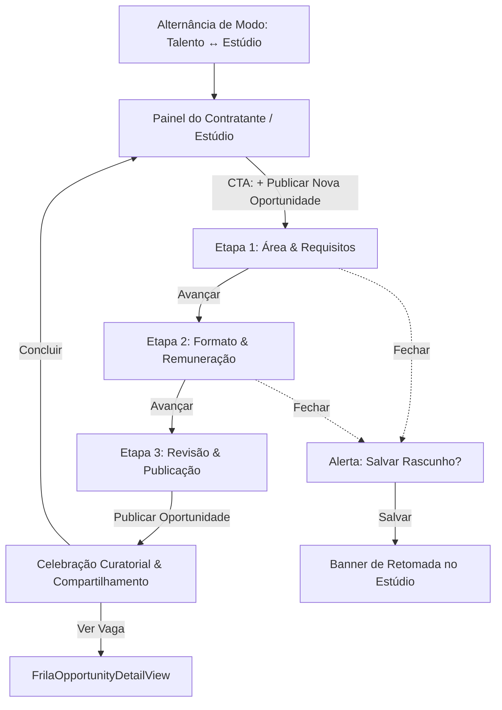

# 🏛️ Especificação de Fluxo: Criação de Oportunidade do Zero (Frila Studio)

> **Documento de Alinhamento de Produto & Gestão de Projeto (GSD)**  
> **Status:** Aprovado & Implementado com Escopo Universal (Zero Middle Dots)  
> **Target:** iOS 26+ / SwiftUI Nativo  
> **Tempo Alvo de Conclusão para o Contratante:** $\le 90$ segundos

---

## 1. Visão Geral & Escopo Abrangente

### 1.1 O Aprendizado com o Airbnb (Refero Flow #6441)
Na análise aprofundada via Refero MCP do fluxo de criação de anúncios do Airbnb (70 telas no mobile), identificamos:
- **Sobrecarga Burocrática do Airbnb:** Telas isoladas para cada amenidade individual, burocracia postal e telas picadas redundantes.
- **O que absorvemos:** A divisão em **3 Macro-Capítulos**, navegação com barra inferior persistente, feedback com numerais táteis e sensação de progresso claro.
- **O que rejeitamos para o Frila:** Telas picadas redundantes. O Frila privilegia **alta velocidade, curadoria e praticidade de uso e conclusão**, sem atrito burocrático.

### 1.2 Pivot de Tom & Escopo: Do Vale do Silício à Realidade Brasileira
O Frila não é restrito a um nicho elitista de tech da Bay Area de São Francisco. Trata-se de uma plataforma universal de contratação de profissionais e autônomos no Brasil. Um contratante no Frila pode criar desde uma vaga para **caixa em padaria artesanal** ou **barista**, até **terapeuta ocupacional para crianças neuro-atípicas**, **designer de identidade visual** ou **engenheiro de software nativo**.

---

## 2. Decisões Arquiteturais e Fundamentos de Design

### 2.1 Persona & Ponto de Entrada (Entry Point)
- **Alternância de Perfil (Apple HIG .principal):** Controle segmentado canônico (`FrilaSegmentedControl`) posicionado diretamente no `ToolbarItem(placement: .principal)` com largura óptica calibrada de 224pt e altura compacta de 32pt (`FrilaGeometry.buttonHeightCompact`), com cápsula de fundo sutil e glider deslizante com mola física (`matchedGeometryEffect`). Substitui títulos estáticos de navegação e evita amnésia de contexto ao rolar.
- **Eliminação de Duplicidade de CTAs:** O atalho secundário redundante `+ Criar Vaga` da `.toolbar` foi eliminado para garantir uma única fonte de ação clara.
- **Modo Estúdio (Painel do Contratante):** A tela principal se adapta imediatamente para a visão executiva de quem contrata:
  - 3 Pilares de métricas curadoriais (`VAGAS ATIVAS`, `PROPOSTAS`, `RESPOSTA`) no topo imediato do viewport.
  - Banner dinâmico de **Retomada de Rascunho** (se houver rascunho salvo).
  - CTA primário autoritativo em Pill Button 44pt HIG padrão: **"+ Publicar Oportunidade"**, disparando o fluxo em `fullScreenCover` no iOS ou modal responsivo no macOS.
  - Exibição imediata das vagas/oportunidades ativas do estúdio acima da dobra.

### 2.2 Decisão Estrutural: Erradicação Completa do Escrow & do Ponto Médio (`·`)
- **Zero Escrow:** O conceito de *Escrow* foi **completamente banido** do Frila. A relação é de contratação direta com transparência integral de remuneração.
- **Zero Ponto de Segmento (`·`):** O caractere `·` (`\u{00B7}`) foi **totalmente erradicado** de todas as strings, cabeçalhos, cartões, chips e notificações do produto. A separação entre metadados agora adota hierarquia tipográfica pura, espaçamentos generosos e travessões em-dash (`—`).

---

## 3. As 3 Macro-Etapas do Curatorial Studio

### Etapa 1: Área & Requisitos (The What)
*Foco na clareza da função, acessível a qualquer tipo de negócio.*
1. **Título Livre da Vaga:**
   - Campo de texto direto: *"Ex: Caixa de Padaria, Terapeuta Ocupacional Infantil, Barista..."*.
2. **Área de Atuação:**
   - Chips táteis (`FrilaFilterChip` com `activationPop`):
     - *Atendimento & Balcão*
     - *Saúde & Terapias*
     - *Gastronomia & Café*
     - *Design & Criação*
     - *Tecnologia & Software*
     - *Educação & Apoio*
     - *Serviços Gerais*
     - *Outras Atividades*
3. **Nível de Experiência Desejado (Grid 2×2 sem truncamento):**
   - *Qualquer Experiência*
   - *Iniciante / Prático*
   - *Intermediário*
   - *Especialista*
4. **Requisitos & Habilidades Principais:**
   - Nuvem de requisitos sugeridos (*Atendimento ao Cliente, Comunicação Clara, Pontualidade, Fechamento de Caixa, Registro Profissional, Trabalho em Equipe, etc.*).
   - **Campo de Adição Personalizada de Requisitos:** Permite que o contratante digite termos específicos (ex: *"Crianças Neuro-atípicas"*, *"Pães de Fermentação Natural"*, *"CREFITO-3"*, *"Figma"*) e adicione com um toque.

---

### Etapa 2: Formato & Remuneração (The Terms)
*Termos de contratação e remuneração alinhados à realidade do trabalho.*
1. **Modalidade de Contratação:**
   - *Diária ou Plantão* — Pagamento por dia, turno ou escala avulsa (ícone: `calendar.badge.clock`).
   - *Projeto Fechado* — Escopo e valor definidos para entrega completa (ícone: `checkmark.seal.fill`).
   - *Mensal ou Recorrente* — Prestação contínua de serviços com remuneração mensal (ícone: `arrow.clockwise.circle`).
   - *Por Hora Trabalhada* — Valor flexível proporcional às horas demandadas (ícone: `clock.fill`).
2. **Duração & Localização:**
   - Presencial (principais capitais brasileiras ou local físico), Híbrido ou Remoto.
3. **Remuneração Proposta:**
   - Slider interativo com faixa abrangente (R$ 15/h a R$ 260/h).
   - Botões de acesso rápido para valores usuais (R$ 20/h, R$ 50/h, R$ 90/h, R$ 160/h, R$ 220/h).
   - Card de **Compensação Total Estimada** com cálculo dinâmico baseado na modalidade e badge de *Contrato Direto*.
   - **Scroll Clearance:** `Spacer().frame(height: 160)` para garantir que o card de compensação e os botões inferiores nunca fiquem encobertos pelo dock.

---

### Etapa 3: Revisão & Publicação (The Reveal)
*Apresentação curatorial e visualização em tempo real.*
1. **Identidade da Vaga & Contratante:**
   - Campo para o nome da empresa ou contratante (ex: *"Padaria Bela Vista"*, *"Clínica Integrar"*).
2. **Foto de Capa Curatorial:**
   - Carrossel fotográfico representativo de diversos setores (Comércio/Balcão, Saúde/Clínica, Café/Gastronomia, Design/Estúdio, Tecnologia, Educação).
   - Integração nativa com `PhotosPicker` (**"Enviar Foto"**) para upload de foto personalizada do estabelecimento ou projeto.
3. **Revelação do Placard (Preview ao Vivo):**
   - Renderização em escala 1:1 do `FrilaOpportunityCard` com animação spring suave (`stiffness: 350, damping: 25`).

---

## 4. Dock Inferior Persistente & Física de Interação

- **Dock Fixo 100% Sólido:** Fundo opaco com `FrilaColor.dynamicCanvas` e borda sutil no topo (`dynamicHairline`), eliminando vazamentos de conteúdo inferior.
- **Pill Buttons:**
  - Botão de Voltar: `FrilaPillButtonStyle(variant: .outline)` (44pt).
  - Botão de Avançar: `FrilaPillButtonStyle(variant: .primary)` (44pt).
  - Botão de Publicação: `FrilaPillButtonStyle(variant: .primary)` (52pt proeminente) com ícone `paperplane.fill`.
- **Celebração Final:** Bottom sheet modal (`FrilaJobCelebrationSheet`) com ações de compartilhamento de link nativo (`ShareLink`) e navegação direta para os detalhes da vaga.

---

## Turno: fluxo linear dos seletores e horas contratadas (2026-10-01)

**Fluxo linear e cíclico.** Data, Início e Fim formam uma sequência dentro do mesmo cartão flutuante (`JobShiftOverlay`). O fluxo começa no campo tocado e segue em ciclo (`JobShiftField.flow(startingAt:)`): entrar por Data percorre Data, Início, Fim; por Início, Início, Fim, Data; por Fim, Fim, Data, Início. Cada campo aparece uma vez. O botão do cartão é "Próximo" com chevron nas etapas intermediárias e "Concluir" na última; cada etapa grava ao avançar. O véu e o cartão ficam durante o fluxo inteiro: avançar troca só o conteúdo, com deslize lateral curto (24 pt) e opacidade. No topo do cartão, uma pequena linha do tempo (`JobShiftStepTitles`): a etapa atual em Bricolage Bold com um ponto laranja e, abaixo, a vizinha (a próxima; na última etapa, a anterior) como fantasma, em Regular, cor apagada e escala 0,88, com um anel vazio e uma trilha de três pontos entre as duas. O fantasma não parece botão, mas é tocável: grava a etapa atual e salta para a vizinha (liberdade de ir e voltar entre Início e Fim). Ao avançar, a troca de peso esmaece com desfoque (M15). A régua de barras foi removida (M16). O cartão é um só container que muda de forma entre etapas (`JobShiftFlowCard`, mola `shiftCardMorph`), com o miolo trocado de forma escalonada, e flutua com a elevação Beautiful Shadows lg (`frilaModalElevation`). No escuro o véu é mais denso (55%), o cartão fica um tom acima do fundo (#2A2A27), o anel sobe para 12% e as camadas de sombra dobram de opacidade: a versão só com anel conflitava com o fundo escuro. Tocar no véu encerra o fluxo e mantém o que já foi confirmado.

**Horas contratadas em evidência.** A duração deixou de ser uma linha de apoio sob os campos: `JobShiftHoursPanel` mostra "Horas contratadas" e o número em SF Pro tabular 26 Bold, com "Termina no dia seguinte" quando o turno vira a noite. Quando o valor muda, o número rola (`numericText`) e, depois de `FrilaMotion.hoursHighlightDelayMs` (380 ms, o tempo de o cartão fechar), a borda do painel acende no tom da marca por `hoursHighlightHold` (0,9 s): o olhar é levado ao valor novo. Movimento reduzido: sem rolagem nem destaque. Erros e o aviso de turno longo continuam como linha abaixo do painel.

**Data em largura total, por extenso (statement "dissolver a informação", `RULES.md` 3.4b).** Data, Início e Fim deixaram de dividir uma linha: a Data ocupa a largura toda e mostra o dia por extenso ("Sexta-feira, 25 de setembro", com "de 2027" só quando o ano muda), com "Hoje" ou "Amanhã" à direita quando couber; Início e Fim dividem a linha de baixo. O rascunho continua guardando "Sex, 25/09", então prévia, resumo e publicação não mudam (`JobShiftFormat.longDateLabel`, `relativeDayLabel`).

**Lista de etapas e alcance com uma mão (modelo A, 2026-10-01).** O cabeçalho de linha do tempo (`JobShiftStepTitles`, atual e fantasma) saiu. No lugar, o cartão mostra as três etapas de uma vez numa lista plana, transplantada da lista aberta do seletor de experiência (`JobShiftStepList`, peças compartilhadas em `FrilaSelectionLayerList.swift`): uma linha de largura total por etapa (Data, Início, Fim, na ordem do formulário), com o nome e o valor atual. A linha ativa mostra o valor vivo do miolo (o dia marcado, o horário parado na roleta, com os dígitos rolando); as demais, o que já está no rascunho, ou "A definir" em cinza apagado (`JobShiftOverview`). Uma camada única de seleção atrás das linhas marca a etapa aberta e desliza até a tocada (`selectionWashSlide`); o nome ganha peso com o cross-fade desfocado. Tocar numa linha grava a etapa atual e salta. "Próximo" e "Concluir" e a ordem cíclica continuam; o rótulo do botão troca de forma escalonada, sem sobrepor as duas palavras. Camada: no claro o campo do grupo (#F6F6F4) com filete de 8% sobre o cartão, agora branco; no escuro um degrau acima do cartão (`dynamicRaisedSelectionLayer`, #393935 sobre #2A2A27).

Ordem de cima para baixo: miolo, lista, botão. O cartão ficou ancorado na base da tela, centrado na horizontal, 24 pt acima do indicador de início, e cresce para cima (M17): em um iPhone 17 Pro (402 × 874 pt) a lista ocupa de 564 a 744 pt e o botão de 756 a 800 pt (64% a 92% da altura), na zona confortável do polegar, e não mudam de lugar entre as etapas; só a borda de cima acompanha o miolo (calendário, cartão de 360 × 655 pt; roleta, 328 × 460 pt). Largura do miolo como teto: calendário 328 pt (já encosta na margem de 20 pt), roleta de 248 para 296 pt (cartão 17% mais largo) e de 150 para 180 pt de altura. O miolo fica preso ao próprio espaço durante o morph, para o calendário não descer sobre a lista.

**Modelo B, experimental: seletor de etapas no topo (2026-10-01, `--shift-nav-picker`).** Hipótese: a lista embaixo do modelo A pesa como carga de entendimento num passo que deveria ser curto (por que a navegação está embaixo?). No B a navegação volta ao topo do cartão como um seletor segmentado com seleção ativa (`JobShiftStepPicker`): trilha em cápsula afundada (claro #EDEDEB, escuro #1C1C1A), três segmentos de 52 pt (Data, Início, Fim) com o nome e o valor curto ("Qui, 1 out", "18:00", "A definir"; `JobShiftFormat.compactDateLabel`) e uma cápsula elevada única que desliza até a etapa aberta (branca com filete no claro, #393935 no escuro), com as mesmas peças da lista do A. O cartão encolhe para ler como um passo rápido: sem a lista de 180 pt, miolo de 320 pt no calendário e 264 × 150 pt na roleta (cartão de 352 × 535 pt e 296 × 310 pt, contra 360 × 655 e 328 × 460 no A). O cartão segue ancorado na base: o botão não sai do lugar; o seletor acompanha a borda de cima (no iPhone 17 Pro, de 297 pt no calendário a 522 pt na roleta). A ordem das etapas, Próximo e Concluir e a gravação ao trocar de etapa são as mesmas do A. O A segue padrão até a comparação dos dois.

**Chegada dos valores no formulário (2026-10-01, A e B).** O fluxo grava Data, Início e Fim sob o véu: quem tocou só em Data voltava ao formulário com Início e Fim preenchidos sem ter visto acontecer, e relia os campos para confiar neles. Agora, ao fechar o cartão, os campos que o fluxo mudou acendem em cascata na ordem do formulário (`JobShiftLanding`, 380 ms depois do toque final e 80 ms entre campos, `shiftLandingStaggerMs`): contorno da marca e um check da marca no lugar da pista ("Hoje" sai antes de o check entrar), e o painel de horas fecha a onda com a mesma borda. Tudo apaga junto depois de `conclusionHold` (1,2 s). O VoiceOver ouve um resumo ("Data, início e fim preenchidos"). De forma permanente, Início e Fim preenchidos ficam na tinta da marca (`dynamicBrandText`, 5,1:1 no claro e 5,5:1 no escuro sobre o campo); a data por extenso segue na cor primária, para a marca não pesar numa linha longa. O painel de horas não acende mais sozinho quando o número muda (no fluxo linear isso acontecia ainda sob o véu): acende só como fim da cascata. Nada avança sozinho (M7).

**Troca de etapa sem travar (2026-10-01, A e B).** Em testes, trocar entre Data e Início travava o redimensionamento e mostrava as duas interfaces sobrepostas por um instante. Três causas, três correções: (1) o miolo era trocado por identidade dentro do layout, então a saída segurava a altura antiga até terminar e o cartão mudava de alvo no meio da mola; agora o espaço do miolo tem altura explícita por etapa (calendário medido, roleta fixa) e os miolos são camadas sobrepostas, fora do cálculo de tamanho; (2) a entrada começava antes de a saída terminar; agora a entrada espera (`FrilaMotion.coreSwapFadeIn`, atraso de 0,1 s depois dos 0,09 s de `contentFadeOut`); (3) o `.animation(value: isActive)` do campo do formulário animava também a troca do texto gravado pelo fluxo, e o texto interpolava entre placeholder e valor ("18:00" virava ":"); agora a animação fica só no contorno e o texto troca por identidade com a troca escalonada. A largura do cartão passou a ser a mesma em todas as etapas (A: miolo 328, cartão 360; B: miolo 312, cartão 344): só a altura muda, o calendário não é cortado nas bordas enquanto o cartão cresce e os segmentos do B não escorregam. As roletas ficam vivas durante o fluxo; o calendário entra e sai da hierarquia, porque escondido ele continuava na árvore do VoiceOver.

## Seletor de função no formulário: Vertical Solto + Borda (2026-10-09)

No passo "Qual é a vaga?", Categoria e Função usam o `FrilaCoupledRolePicker` na variante **Vertical (Empilhado), Solto, Borda**: dois campos empilhados, cada um com o rótulo acima, sem cartão de grupo em volta, no mesmo ritmo de Estabelecimento e Endereço. O valor confirmado é marcado só pela borda de acento (`FrilaConfirmedFieldStyle.accentBorder`), sem preenchimento. As demais variantes (eixo horizontal, grupos Grafite, Pedra e Laranja, confirmado Laranja e Tinta) seguem disponíveis no Design Lab e no componente. O seletor de experiência desejada mantém a paleta de `pickerGroupStyle`.
