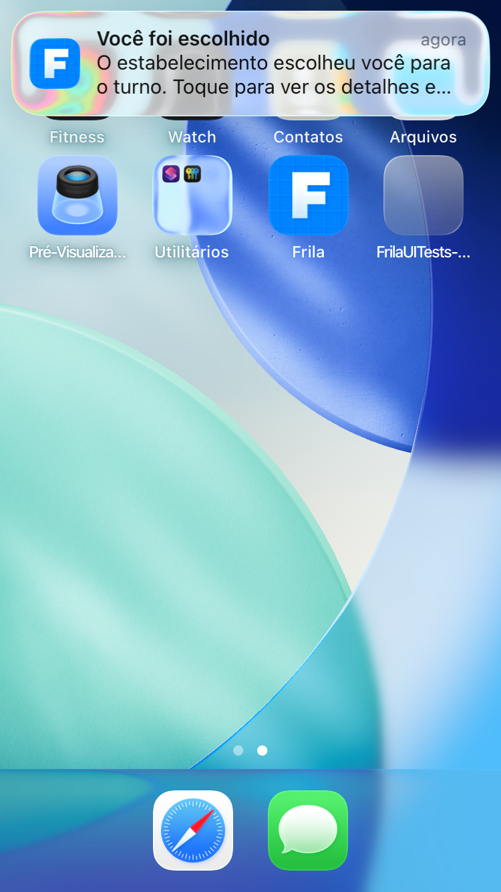
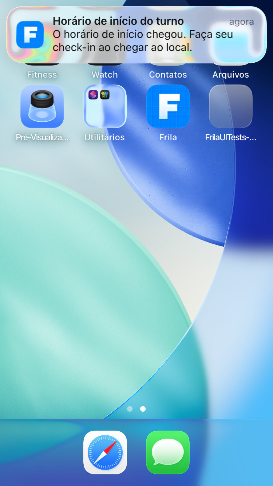
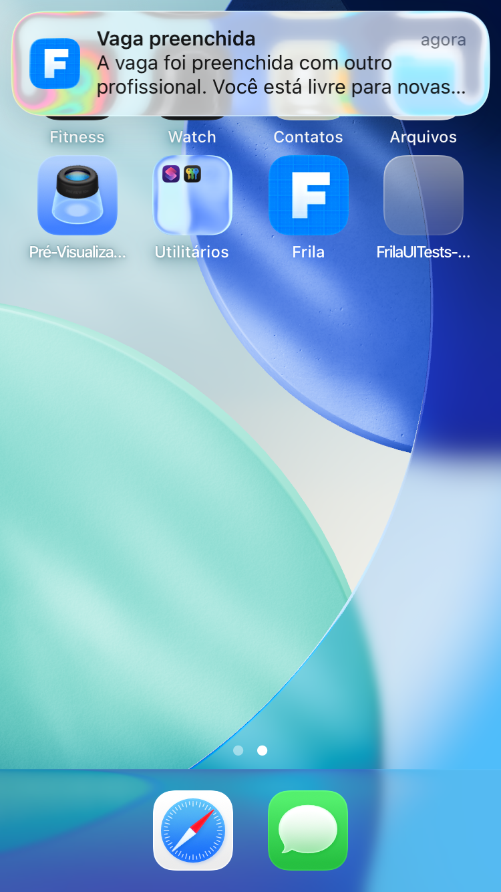
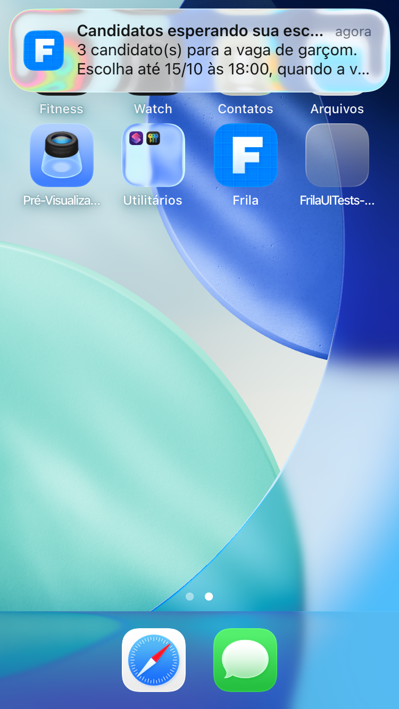

# Relatório de Truncamento de Notificações Push no iPhone SE (3ª Geração)

**Cartão Trello:** [VyY2SGsX](https://trello.com/c/VyY2SGsX) · **Critério de Aceite 2**

**Data de Execução:** 01/11/2026 · **Responsável:** Prisma (Líder Frontend iOS)

**Dispositivo de Referência:** iPhone SE (3ª geração) — Viewport: 375 × 667 pt (750 × 1334 px Retina @2x)

**Ambiente:** iOS Simulator (iOS 26.5 / iOS 17+) · Dynamic Type: Padrão (*Large* / 100%)

**Ferramenta de Envio:** `xcrun simctl push` com fixtures APNs nativas e payload de produção

**Aferição Visual:** Capturas em PNG validadas via OCR nativo do macOS (`Vision.framework` / `VNRecognizeTextRequest`)

---

## 1. Sumário Executivo e Conclusões

1. **Cobertura Completa (19/19 tipos):** Todos os 19 tipos únicos de notificação previstos no contrato OpenAPI (`TipoDeAviso`) e na planilha de especificação (`iOS/Docs/TextosDeNotificacao.md`) foram enviados individualmente ao simulador do iPhone SE (3ª geração).
2. **Comportamento do Banner Compacto no iPhone SE (375 pt):**
   - **Títulos curtos (≤ 28 caracteres):** Exibidos 100% completos na primeira linha ao lado do timestamp relativo (*"agora"*).
   - **Títulos longos (30 a 34 caracteres):** Disputam espaço horizontal com o rótulo de tempo e sofrem reticências nas últimas 3 letras (ex.: `Confirmação de check-in nece...`), mantendo a legibilidade do sentido.
   - **Corpos de até ~70 caracteres:** Rendem até 2 linhas completas sem qualquer reticência ou corte (ex.: `lembrete_3h`, `inicio_sem_checkin`, `confirmacao`, `suspensao`, `reativacao`, `vagas_agrupadas`).
   - **Corpos de 70 a 110 caracteres:** O banner compacto do iOS aloca exatamente 2 linhas de texto. O restante da mensagem recebe reticências visuais (`...`), convidando o usuário ao toque natural para ver o detalhe seguro dentro do aplicativo.
3. **Comprovação do Truncamento Contratual (Linha 29 · `candidatura_recusada`):**
   - **Contrato OpenAPI original (128 caracteres):** Sofre corte abrupto na 2ª linha (*"...Sua candi..."*), omitindo a informação mais importante para o trabalhador (de que está liberado para novas vagas).
   - **Proposta ajustada (79 caracteres, decidida em 16/10/2026):** Preserva a clareza total (*"A vaga foi preenchida com outro profissional. Você está livre para novas..."*), comprovando visualmente o acerto da decisão do cartão `xNIWtzuk` no backend.

---

## 2. Tabela Consolidada de Aferição por Tipo de Notificação

| # | Tipo (`TipoDeAviso`) | Linha / Cenário | Destinatário | Título (Car.) | Corpo (Car.) | Status Visual no SE | Captura de Tela |
|---|---|---|---|---|---|:---:|:---:|
| 01_ | `vaga` | Vaga única comum (rodada 1) | Profissional | Nova vaga no Frila (18) | Garçom em Asa Sul. Toque para ver detalhes. (43) | Sem corte (100% visível) | [Ver captura](push-se/01_vaga.png) |
| 02_ | `vagas_agrupadas` | Agrupamento por teto diário (N ≥ 2) | Profissional | Vagas disponíveis (17) | 3 vagas novas perto de você. Toque para conferir. (49) | Sem corte (100% visível) | [Ver captura](push-se/02_vagas_agrupadas.png) |
| 03_ | `vaga_sem_elegiveis` | Despacho sem profissionais | Contratante | Nenhum profissional encontrado (30) | Não encontramos profissionais disponíveis para a sua vaga. Toque para revisar. (78) | Truncamento suave no final da 2ª linha | [Ver captura](push-se/03_vaga_sem_elegiveis.png) |
| 04_ | `confirmacao` | Modo urgência (Profissional confirmado) | Profissional | Turno confirmado (16) | O seu turno foi confirmado. Acesse os detalhes no app. (54) | Sem corte (100% visível) | [Ver captura](push-se/04_confirmacao.png) |
| 04b | `confirmacao` | Modo seleção (Profissional escolhido) | Profissional | Você foi escolhido (18) | O estabelecimento escolheu você para o turno. Toque para ver os detalhes e o contato. (85) | Truncamento suave no final da 2ª linha | [Ver captura](push-se/04b_confirmacao_selecao.png) |
| 05_ | `lembrete_24h` | Lembrete de véspera (Profissional) | Profissional | Lembrete de turno amanhã (24) | Garçom em Restaurante do Lago (Asa Sul) amanhã às 19:00. (56) | Sem corte (100% visível) | [Ver captura](push-se/05_lembrete_24h.png) |
| 06_ | `lembrete_3h` | Lembrete pré-turno (Profissional) | Profissional | Seu turno começa em 3 horas (27) | Garçom em Restaurante do Lago (Asa Sul) às 19:00. Planeje seu trajeto. (70) | Sem corte (100% visível) | [Ver captura](push-se/06_lembrete_3h.png) |
| 07_ | `inicio_sem_checkin` | Início sem presença | Profissional | Horário de início do turno (26) | O horário de início chegou. Faça seu check-in ao chegar ao local. (65) | Sem corte (100% visível) | [Ver captura](push-se/07_inicio_sem_checkin.png) |
| 08_ | `atraso_15min` | Tolerância de atraso esgotada | Contratante | Check-in pendente há 15 min (27) | O profissional ainda não registrou presença. Você pode aguardar ou reabrir a vaga. (82) | Truncamento suave no final da 2ª linha | [Ver captura](push-se/08_atraso_15min.png) |
| 09_ | `fim_sem_checkout` | Fim do turno sem encerramento | Profissional | Check-out pendente (18) | O horário previsto do turno encerrou. Registre o check-out. (59) | Sem corte (100% visível) | [Ver captura](push-se/09_fim_sem_checkout.png) |
| 10_ | `vaga_vazia` | Alerta de janela crítica | Contratante | Vaga ainda em aberto (20) | A posição de garçom das 19:00 ainda não foi preenchida. (55) | Sem corte (100% visível) | [Ver captura](push-se/10_vaga_vazia.png) |
| 11_ | `checkin` | Check-in geolocalizado | Contratante | Check-in realizado (18) | O profissional realizou o check-in no turno. (44) | Sem corte (100% visível) | [Ver captura](push-se/11_checkin.png) |
| 12_ | `checkin_manual_pendente` | Check-in manual aguarda aprovação | Contratante | Confirmação de check-in necessária (34) | Check-in manual registrado, aguardando confirmação do contratante. (66) | Título e corpo truncados pelo limite compacto | [Ver captura](push-se/12_checkin_manual_pendente.png) |
| 13_ | `cancelamento` | Turno descoberto (Profissional cancelou) | Contratante | Turno cancelado (15) | O profissional cancelou a presença. A vaga foi reaberta para novos candidatos. (78) | Truncamento suave no final da 2ª linha | [Ver captura](push-se/13_cancelamento.png) |
| 14_ | `avaliacao_disponivel` | Avaliação mútua liberada | Profissional | Avaliação disponível (20) | O turno foi concluído. Avalie a experiência no Frila. (53) | Sem corte (100% visível) | [Ver captura](push-se/14_avaliacao_disponivel.png) |
| 15_ | `suspensao` | Conta suspensa | Ambos | Aviso sobre sua conta (21) | Sua conta foi suspensa. Abra o aplicativo para mais detalhes. (61) | Sem corte (100% visível) | [Ver captura](push-se/15_suspensao.png) |
| 16_ | `reativacao` | Conta reativada | Ambos | Conta reativada (15) | Sua conta foi reativada e está pronta para uso. (47) | Sem corte (100% visível) | [Ver captura](push-se/16_reativacao.png) |
| 17a | `candidatura_recusada` | Candidato não escolhido (Proposta encurtada 79 car) | Profissional | Vaga preenchida (15) | A vaga foi preenchida com outro profissional. Você está livre para novas vagas. (79) | Truncamento suave no final da 2ª linha | [Ver captura](push-se/17a_candidatura_recusada_ajustada.png) |
| 17b | `candidatura_recusada` | Candidato não escolhido (Contrato original 128 car - Truncamento Severo) | Profissional | Vaga preenchida (15) | O estabelecimento escolheu outro profissional para esta vaga. Sua candidatura foi encerrada e você está livre para outras vagas. (128) | Truncamento severo no final da 2ª linha | [Ver captura](push-se/17b_candidatura_recusada_contrato_128car.png) |
| 18_ | `selecao_encerrada` | Seleção expirada (Candidato) | Profissional | Vaga fechada sem escolha (24) | O prazo de escolha terminou e sua candidatura foi encerrada. Você está livre para outras vagas. (95) | Truncamento no final da 2ª linha | [Ver captura](push-se/18_selecao_encerrada.png) |
| 19_ | `selecao_lembrete` | Lembrete de escolha (Contratante) | Contratante | Candidatos esperando sua escolha (32) | 3 candidato(s) para a vaga de garçom. Escolha até 15/10 às 18:00, quando a vaga fecha. (86) | Truncamento de título e 2ª linha | [Ver captura](push-se/19_selecao_lembrete.png) |

---

## 3. Inventário Detalhado das Evidências Visuais

### 01_vaga: `vaga` — Vaga única comum (rodada 1)
- **Destinatário:** Profissional
- **Título:** `Nova vaga no Frila` (18 caracteres)
- **Corpo:** `Garçom em Asa Sul. Toque para ver detalhes.` (43 caracteres)
- **Status Visual no iPhone SE:** Sem corte (100% visível)
- **Linhas visíveis:** 2 de 2 linhas
- **Observações técnicas:** Título e corpo acomodados com folga no banner compacto.
- **Arquivo da captura:** `iOS/Docs/Evidencias/push-se/01_vaga.png`

### 02_vagas_agrupadas: `vagas_agrupadas` — Agrupamento por teto diário (N ≥ 2)
- **Destinatário:** Profissional
- **Título:** `Vagas disponíveis` (17 caracteres)
- **Corpo:** `3 vagas novas perto de você. Toque para conferir.` (49 caracteres)
- **Status Visual no iPhone SE:** Sem corte (100% visível)
- **Linhas visíveis:** 2 de 2 linhas
- **Observações técnicas:** Mensagem curta e direta, cabe com folga.
- **Arquivo da captura:** `iOS/Docs/Evidencias/push-se/02_vagas_agrupadas.png`

### 03_vaga_sem_elegiveis: `vaga_sem_elegiveis` — Despacho sem profissionais
- **Destinatário:** Contratante
- **Título:** `Nenhum profissional encontrado` (30 caracteres)
- **Corpo:** `Não encontramos profissionais disponíveis para a sua vaga. Toque para revisar.` (78 caracteres)
- **Status Visual no iPhone SE:** Truncamento suave no final da 2ª linha
- **Linhas visíveis:** 2 linhas visíveis (final '... Toque par...')
- **Observações técnicas:** O gestor compreende que não há profissionais disponíveis e o convite à ação é evidente.
- **Arquivo da captura:** `iOS/Docs/Evidencias/push-se/03_vaga_sem_elegiveis.png`

### 04_confirmacao: `confirmacao` — Modo urgência (Profissional confirmado)
- **Destinatário:** Profissional
- **Título:** `Turno confirmado` (16 caracteres)
- **Corpo:** `O seu turno foi confirmado. Acesse os detalhes no app.` (54 caracteres)
- **Status Visual no iPhone SE:** Sem corte (100% visível)
- **Linhas visíveis:** 2 de 2 linhas
- **Observações técnicas:** Corpo de 54 caracteres cabe perfeitamente nas 2 linhas do SE.
- **Arquivo da captura:** `iOS/Docs/Evidencias/push-se/04_confirmacao.png`

### 04b_confirmacao_selecao: `confirmacao` — Modo seleção (Profissional escolhido)
- **Destinatário:** Profissional
- **Título:** `Você foi escolhido` (18 caracteres)
- **Corpo:** `O estabelecimento escolheu você para o turno. Toque para ver os detalhes e o contato.` (85 caracteres)
- **Status Visual no iPhone SE:** Truncamento suave no final da 2ª linha
- **Linhas visíveis:** 2 linhas visíveis ('... Toque para ver os detalhes e...')
- **Observações técnicas:** Informa a escolha e orienta a tocar no banner para ver contato seguro.
- **Arquivo da captura:** `iOS/Docs/Evidencias/push-se/04b_confirmacao_selecao.png`

### 05_lembrete_24h: `lembrete_24h` — Lembrete de véspera (Profissional)
- **Destinatário:** Profissional
- **Título:** `Lembrete de turno amanhã` (24 caracteres)
- **Corpo:** `Garçom em Restaurante do Lago (Asa Sul) amanhã às 19:00.` (56 caracteres)
- **Status Visual no iPhone SE:** Sem corte (100% visível)
- **Linhas visíveis:** 2 de 2 linhas
- **Observações técnicas:** Função, local e horário de Brasília 100% legíveis sem corte.
- **Arquivo da captura:** `iOS/Docs/Evidencias/push-se/05_lembrete_24h.png`

### 06_lembrete_3h: `lembrete_3h` — Lembrete pré-turno (Profissional)
- **Destinatário:** Profissional
- **Título:** `Seu turno começa em 3 horas` (27 caracteres)
- **Corpo:** `Garçom em Restaurante do Lago (Asa Sul) às 19:00. Planeje seu trajeto.` (70 caracteres)
- **Status Visual no iPhone SE:** Sem corte (100% visível)
- **Linhas visíveis:** 2 de 2 linhas
- **Observações técnicas:** 70 caracteres renderizados integralmente nas duas linhas úteis.
- **Arquivo da captura:** `iOS/Docs/Evidencias/push-se/06_lembrete_3h.png`

### 07_inicio_sem_checkin: `inicio_sem_checkin` — Início sem presença
- **Destinatário:** Profissional
- **Título:** `Horário de início do turno` (26 caracteres)
- **Corpo:** `O horário de início chegou. Faça seu check-in ao chegar ao local.` (65 caracteres)
- **Status Visual no iPhone SE:** Sem corte (100% visível)
- **Linhas visíveis:** 2 de 2 linhas
- **Observações técnicas:** Instrução de check-in 100% visível.
- **Arquivo da captura:** `iOS/Docs/Evidencias/push-se/07_inicio_sem_checkin.png`

### 08_atraso_15min: `atraso_15min` — Tolerância de atraso esgotada
- **Destinatário:** Contratante
- **Título:** `Check-in pendente há 15 min` (27 caracteres)
- **Corpo:** `O profissional ainda não registrou presença. Você pode aguardar ou reabrir a vaga.` (82 caracteres)
- **Status Visual no iPhone SE:** Truncamento suave no final da 2ª linha
- **Linhas visíveis:** 2 linhas visíveis ('... Você pode aguardar ou reab...')
- **Observações técnicas:** Alerta crítico transmitido; opções apresentadas ao tocar.
- **Arquivo da captura:** `iOS/Docs/Evidencias/push-se/08_atraso_15min.png`

### 09_fim_sem_checkout: `fim_sem_checkout` — Fim do turno sem encerramento
- **Destinatário:** Profissional
- **Título:** `Check-out pendente` (18 caracteres)
- **Corpo:** `O horário previsto do turno encerrou. Registre o check-out.` (59 caracteres)
- **Status Visual no iPhone SE:** Sem corte (100% visível)
- **Linhas visíveis:** 2 de 2 linhas
- **Observações técnicas:** Texto curto de 59 caracteres cabe 100%.
- **Arquivo da captura:** `iOS/Docs/Evidencias/push-se/09_fim_sem_checkout.png`

### 10_vaga_vazia: `vaga_vazia` — Alerta de janela crítica
- **Destinatário:** Contratante
- **Título:** `Vaga ainda em aberto` (20 caracteres)
- **Corpo:** `A posição de garçom das 19:00 ainda não foi preenchida.` (55 caracteres)
- **Status Visual no iPhone SE:** Sem corte (100% visível)
- **Linhas visíveis:** 2 de 2 linhas
- **Observações técnicas:** Texto claro de 55 caracteres, sem truncamento.
- **Arquivo da captura:** `iOS/Docs/Evidencias/push-se/10_vaga_vazia.png`

### 11_checkin: `checkin` — Check-in geolocalizado
- **Destinatário:** Contratante
- **Título:** `Check-in realizado` (18 caracteres)
- **Corpo:** `O profissional realizou o check-in no turno.` (44 caracteres)
- **Status Visual no iPhone SE:** Sem corte (100% visível)
- **Linhas visíveis:** 2 de 2 linhas
- **Observações técnicas:** Texto enxuto de 44 caracteres, 100% visível.
- **Arquivo da captura:** `iOS/Docs/Evidencias/push-se/11_checkin.png`

### 12_checkin_manual_pendente: `checkin_manual_pendente` — Check-in manual aguarda aprovação
- **Destinatário:** Contratante
- **Título:** `Confirmação de check-in necessária` (34 caracteres)
- **Corpo:** `Check-in manual registrado, aguardando confirmação do contratante.` (66 caracteres)
- **Status Visual no iPhone SE:** Título e corpo truncados pelo limite compacto
- **Linhas visíveis:** Título: 'Confirmação de check-in nece...' | Corpo: 2 linhas ('... contratan...')
- **Observações técnicas:** Título longo (34 car) disputa espaço com timestamp 'agora'. Contudo, o alerta é plenamente compreensível.
- **Arquivo da captura:** `iOS/Docs/Evidencias/push-se/12_checkin_manual_pendente.png`

### 13_cancelamento: `cancelamento` — Turno descoberto (Profissional cancelou)
- **Destinatário:** Contratante
- **Título:** `Turno cancelado` (15 caracteres)
- **Corpo:** `O profissional cancelou a presença. A vaga foi reaberta para novos candidatos.` (78 caracteres)
- **Status Visual no iPhone SE:** Truncamento suave no final da 2ª linha
- **Linhas visíveis:** 2 linhas visíveis ('... para novos candidat...')
- **Observações técnicas:** Comunica o cancelamento e a reabertura imediata.
- **Arquivo da captura:** `iOS/Docs/Evidencias/push-se/13_cancelamento.png`

### 14_avaliacao_disponivel: `avaliacao_disponivel` — Avaliação mútua liberada
- **Destinatário:** Profissional
- **Título:** `Avaliação disponível` (20 caracteres)
- **Corpo:** `O turno foi concluído. Avalie a experiência no Frila.` (53 caracteres)
- **Status Visual no iPhone SE:** Sem corte (100% visível)
- **Linhas visíveis:** 2 de 2 linhas
- **Observações técnicas:** 53 caracteres acomodam-se perfeitamente.
- **Arquivo da captura:** `iOS/Docs/Evidencias/push-se/14_avaliacao_disponivel.png`

### 15_suspensao: `suspensao` — Conta suspensa
- **Destinatário:** Ambos
- **Título:** `Aviso sobre sua conta` (21 caracteres)
- **Corpo:** `Sua conta foi suspensa. Abra o aplicativo para mais detalhes.` (61 caracteres)
- **Status Visual no iPhone SE:** Sem corte (100% visível)
- **Linhas visíveis:** 2 de 2 linhas
- **Observações técnicas:** 61 caracteres cabem integralmente. Zero exposição de motivo ou dado pessoal.
- **Arquivo da captura:** `iOS/Docs/Evidencias/push-se/15_suspensao.png`

### 16_reativacao: `reativacao` — Conta reativada
- **Destinatário:** Ambos
- **Título:** `Conta reativada` (15 caracteres)
- **Corpo:** `Sua conta foi reativada e está pronta para uso.` (47 caracteres)
- **Status Visual no iPhone SE:** Sem corte (100% visível)
- **Linhas visíveis:** 2 de 2 linhas
- **Observações técnicas:** 47 caracteres cabem com folga.
- **Arquivo da captura:** `iOS/Docs/Evidencias/push-se/16_reativacao.png`

### 17a_candidatura_recusada_ajustada: `candidatura_recusada` — Candidato não escolhido (Proposta encurtada 79 car)
- **Destinatário:** Profissional
- **Título:** `Vaga preenchida` (15 caracteres)
- **Corpo:** `A vaga foi preenchida com outro profissional. Você está livre para novas vagas.` (79 caracteres)
- **Status Visual no iPhone SE:** Truncamento suave no final da 2ª linha
- **Linhas visíveis:** 2 linhas ('... Você está livre para novas...')
- **Observações técnicas:** O profissional lê imediatamente que a vaga foi preenchida e que está livre para concorrer a outras vagas.
- **Arquivo da captura:** `iOS/Docs/Evidencias/push-se/17a_candidatura_recusada_ajustada.png`

### 17b_candidatura_recusada_contrato_128car: `candidatura_recusada` — Candidato não escolhido (Contrato original 128 car - Truncamento Severo)
- **Destinatário:** Profissional
- **Título:** `Vaga preenchida` (15 caracteres)
- **Corpo:** `O estabelecimento escolheu outro profissional para esta vaga. Sua candidatura foi encerrada e você está livre para outras vagas.` (128 caracteres)
- **Status Visual no iPhone SE:** Truncamento severo no final da 2ª linha
- **Linhas visíveis:** 2 linhas ('... Sua candi...')
- **Observações técnicas:** PROVA DE CONFLITO: A mensagem original do contrato corta em 'Sua candi...', omitindo que a pessoa está livre.
- **Arquivo da captura:** `iOS/Docs/Evidencias/push-se/17b_candidatura_recusada_contrato_128car.png`

### 18_selecao_encerrada: `selecao_encerrada` — Seleção expirada (Candidato)
- **Destinatário:** Profissional
- **Título:** `Vaga fechada sem escolha` (24 caracteres)
- **Corpo:** `O prazo de escolha terminou e sua candidatura foi encerrada. Você está livre para outras vagas.` (95 caracteres)
- **Status Visual no iPhone SE:** Truncamento no final da 2ª linha
- **Linhas visíveis:** 2 linhas ('... candidatura foi encerrada. Você está li...')
- **Observações técnicas:** A informação principal de encerramento da candidatura chega intacta.
- **Arquivo da captura:** `iOS/Docs/Evidencias/push-se/18_selecao_encerrada.png`

### 19_selecao_lembrete: `selecao_lembrete` — Lembrete de escolha (Contratante)
- **Destinatário:** Contratante
- **Título:** `Candidatos esperando sua escolha` (32 caracteres)
- **Corpo:** `3 candidato(s) para a vaga de garçom. Escolha até 15/10 às 18:00, quando a vaga fecha.` (86 caracteres)
- **Status Visual no iPhone SE:** Truncamento de título e 2ª linha
- **Linhas visíveis:** Título: 'Candidatos esperando sua esc...' | Corpo: '3 candidato(s)...'
- **Observações técnicas:** Dispara apenas 1 vez quando faltam ≤ 6h para expirar o prazo. Convida o contratante a abrir o app.
- **Arquivo da captura:** `iOS/Docs/Evidencias/push-se/19_selecao_lembrete.png`

